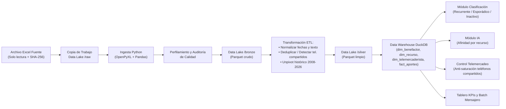

# Entregable 1 (Avance 1): Formulación del Proyecto, Arquitectura y Preparación de Datos

**Proyecto:** Plataforma Analítica e Inteligente de Benefactores y Captación de Recursos – **Fundación 1380** (SIBDA-1380)  
**Asignatura:** ET0155 – Fundamentos de Big Data  
**Programa:** Tecnología en Desarrollo de Software (Semestre III)  
**Entregable:** Avance 1 – Formulación del proyecto, arquitectura y preparación de los datos  

---

## 1. Nombre del Proyecto

**SIBDA-1380: Sistema Integrado de Big Data y Analítica para la Gestión de Benefactores, Predicción de Afinidad y Optimización de Captación de Recursos – Fundación 1380.**

---

## 2. Descripción del Problema Identificado

La **Fundación 1380** es una organización sin ánimo de lucro cuyo sostenimiento depende de los aportes de sus benefactores mediante distintos mecanismos de captación: donaciones directas, bonos, rifas (cantarrilla, Virgen del Carmen), alcancías, bingos, banquetes navideños y eventos parroquiales.

Actualmente, la gestión histórica y operativa se centraliza en un único libro de Excel plano (`BD_F1380_SeudonimizadaAnonimizadaencriptada.xlsx`) de **2.744 registros y 130 columnas**, lo cual genera las siguientes problemáticas críticas verificadas en el análisis inicial:

1. **Estructura matricial desnormalizada y difícil de consultar:** En una sola hoja (`Hoja1`) coexisten datos maestros del benefactor (código, nombres, cédula, teléfono, dirección), seguimiento CRM de telemercadeo (cumpleaños, observaciones de salud/calamidad, encuesta de eventos) y un histórico financiero horizontal de **19 años (2008–2026)** con columnas repetidas por mes (`ENE`, `ENE.1`, `ENERO`) y bonos (`BONOS.1`–`BONOS.6`).
2. **Problemas severos de calidad de datos:**
   - **Tipos mixtos en columnas clave:** Fechas mezcladas entre seriales numéricos de Excel y texto inválido (`27/'8/2020`, `29/15/2015`, `RETIRAR`, `BAZAR LUMEN DEI`); campos monetarios o de bonos con comentarios incrustados (`549-804`, `08/09/26 le hablo del bono`, `variable`).
   - **Alta dispersión categórica:** La columna `SOCIO` presenta **97 variantes textuales** distintas al mezclar el tipo de vínculo (`BONOS`, `ESP`, `PERM`) con notas familiares o de retiro (`PERM-DONA CON SU ESPOSO`, `Retirar `, `Tardes NSE y tia de Viviana Uribe`).
   - **Valores faltantes críticos:** Ausencia de cédula en 201 registros (7,3 %), teléfono en 315 (11,5 %), fecha de ingreso en 493 (18,0 %) y año de nacimiento en 2.429 (88,5 %).
   - **Inconsistencias aritméticas:** Diferencias entre columnas resumen (`2024`, `TOTAL 2025`) y el desglose mensual correspondiente (p. ej., registros donde `2024` omite el valor de `BONOS DICIEMBRE`, o valores atípicos como `1` en `ABR.1`).
3. **Duplicidad y teléfonos compartidos sin control de saturación:** Se detectaron **57 grupos de cédulas repetidas**, **40 grupos de nombres duplicados** y **156 grupos de teléfonos compartidos** (hasta **7 personas** distintas bajo el mismo número). Al no contar con control centralizado, múltiples telemercaderistas (Sandra, Viviana, Lina, etc.) pueden contactar en un mismo día a una misma familia.
4. **Ausencia de analítica predictiva y trazabilidad:** Las decisiones de asignación de recursos y campañas se toman de forma manual, sin modelos que estimen la afinidad de cada benefactor ni procesos batch automatizados para logística (mensajero) o gobierno de datos.

### Pregunta orientadora del proyecto
> *¿Cómo puede la Fundación 1380 utilizar sus datos históricos para mejorar la gestión de sus benefactores, optimizar la captación de recursos y tomar decisiones basadas en información confiable?*

---

## 3. Objetivo General y Objetivos Específicos

### Objetivo General
Diseñar e implementar un prototipo funcional basado en arquitectura Big Data, analítica de datos e inteligencia artificial que permita ingerir, depurar, almacenar, clasificar, predecir y visualizar la información histórica de los benefactores y sus aportes, optimizando la gestión de las telemercaderistas y la captación de recursos de la Fundación 1380.

### Objetivos Específicos
1. Analizar la estructura, el esquema y la calidad de la información almacenada en el archivo Excel histórico sin alterar la fuente original.
2. Implementar un proceso ETL reproducible en Python que normalice fechas, categorías, montos y transforme la matriz histórica horizontal en tablas analíticas normalizadas.
3. Diseñar e implementar una arquitectura de almacenamiento de dos capas: **Data Lake** (conservación inmutable en bruto y Parquet) y **Data Warehouse** (modelo dimensional analítico en DuckDB).
4. Establecer lineamientos y controles de **Gobierno, Calidad, Seguridad y Protección de Datos** (seudonimización, control de acceso, trazabilidad y copias de respaldo).
5. Desarrollar un módulo analítico de clasificación histórica de benefactores (recurrentes, esporádicos, único aporte y sin aportes recientes) y detección de aportes familiares.
6. Construir y evaluar un modelo de Inteligencia Artificial para estimar la afinidad o probabilidad de participación de cada benefactor por recurso de captación.
7. Diseñar un módulo de gestión de contactos para telemercaderistas que prevenga la saturación de **teléfonos compartidos** sin fusionar identidades individuales.
8. Desarrollar un tablero de indicadores (KPIs / CMI / Data Storytelling) y un proceso batch para la generación del reporte logístico del mensajero.

---

## 4. Identificación de Requerimientos Funcionales

| ID | Módulo | Requerimiento Funcional | Prioridad |
| :--- | :--- | :--- | :--- |
| **RF-01** | ETL / Ingesta | Cargar archivos Excel desde almacenamiento local o Google Drive trabajando siempre sobre una copia inmutable (el Excel original nunca se modifica). | Alta |
| **RF-02** | ETL / Diagnóstico | Inspeccionar automáticamente hojas, columnas, tipos de dato, valores nulos, duplicados y anomalías de formato. | Alta |
| **RF-03** | ETL / Transformación | Normalizar fechas (seriales Excel y cadenas), limpiar espacios, estandarizar categorías (`SOCIO`, `TRATO`, `TIPO PAGO`, `Municipio`) y desnormalizar el histórico 2008–2026 a tabla de hechos de aportes. | Alta |
| **RF-04** | Almacenamiento | Persistir datos crudos e históricos en **Data Lake** (formato Parquet) y cargar el modelo estructurado en **Data Warehouse** (DuckDB). | Alta |
| **RF-05** | Analítica / Clasificación | Clasificar benefactores en *Permanente/Recurrente*, *Esporádico*, *Único aporte* y *Sin aportes recientes*, calculando frecuencia, recencia, valor acumulado/promedio y recurso favorito. | Alta |
| **RF-06** | Inteligencia Artificial | Estimar la afinidad de un benefactor con un recurso de captación configurable filtrando por telemercaderista, fecha de gestión y recurso. | Alta |
| **RF-07** | Telemercadeo | Gestionar agenda de contactos y bloquear/alertar colisiones de llamadas en el mismo día para **teléfonos compartidos** manteniendo cada benefactor como entidad independiente. | Alta |
| **RF-08** | Visualización / KPIs | Desplegar tablero de control con indicadores de benefactores, recaudación por recurso/período y desempeño por telemercaderista. | Media |
| **RF-09** | Proceso Batch | Extraer en lote las transacciones del día anterior que requieran mensajería y exportar un reporte imprimible sin datos personales innecesarios. | Media |
| **RF-10** | Gobierno y Seguridad | Registrar bitácora de trazabilidad de transformaciones, verificación de hash, roles de acceso y preservación de seudonimización. | Alta |

---

## 5. Arquitectura Propuesta de la Solución Big Data

La solución adopta una arquitectura **Lakehouse / Multicapa por Lotes (Batch)** alineada con el ciclo de vida del dato visto en clase (*Captura → Almacenamiento → Tratamiento/ETL → Modelado/IA → Visualización/Consumo*), gobernada transversalmente por reglas de calidad y seguridad:

```
┌──────────────────────────────────────────────────────────────────────────────┐
│                 CAPA TRANSVERSAL: GOBIERNO, CALIDAD Y SEGURIDAD             │
│  • Inmutabilidad de fuente (SHA-256)   • Seudonimización (PER_/ID_/TEL_/UBI_)│
│  • Trazabilidad / Logs de ETL          • Control de acceso por rol           │
└──────────────────────────────────────────────────────────────────────────────┘
         │                      │                     │                   │
         ▼                      ▼                     ▼                   ▼
┌─────────────────┐   ┌───────────────────┐   ┌───────────────┐   ┌──────────────┐
│ 1. FUENTE       │   │ 2. DATA LAKE      │   │ 3. ETL        │   │ 4. DATA      │
│    ORIGINAL     │──▶│   (Google Drive)  │──▶│  (Python /    │──▶│  WAREHOUSE   │
│ • Excel (.xlsx) │   │ • Raw (copia)     │   │   Pandas)     │   │  (DuckDB)    │
│   Solo lectura  │   │ • Bronze (Parquet)│   │ • Limpieza    │   │ • Esquema    │
│                 │   │ • Silver (Parquet)│   │ • Unpivot     │   │   Estrella   │
└─────────────────┘   └───────────────────┘   └───────────────┘   └──────────────┘
                                                                         │
         ┌───────────────────────────────────────────────────────────────┘
         ▼
┌──────────────────────────────────────────────────────────────────────────────┐
│ 5. CAPA DE ANALÍTICA, IA Y CONSUMO OPERATIVO                                 │
│  • Clasificación RFM/Reglas   • Modelo IA (Scikit-learn)   • Control Teléf.  │
│  • Dashboard KPI (Plotly/Streamlit)   • Script Batch Mensajero (PDF/CSV)     │
└──────────────────────────────────────────────────────────────────────────────┘
```

### ¿Por qué corresponde a una solución Big Data?
Aunque el archivo actual pesa ~1,6 MB, la arquitectura resuelve las dimensiones clásicas de Big Data aplicadas al caso real de la Fundación:
- **Variedad:** Integra datos estructurados (montos, fechas), semiestructurados (códigos y rangos de boletas/cantarrillas) y no estructurados (comentarios en texto libre de salud, calamidades, cumpleaños y parentescos).
- **Veracidad:** El reto principal del caso es convertir datos ruidosos, duplicados e inconsistentes en *Smart Data* confiable para la toma de decisiones (DDDM).
- **Volumen y Escalabilidad Histórica:** Consolida 19 años de historia (2008–2026) que al normalizarse pasan de 2.744 filas anchas a decenas de miles de registros transaccionales listos para crecer con nuevas versiones del Excel mediante almacenamiento columnar (Parquet) y motor OLAP vectorizado (DuckDB).

---

## 6. Diagrama de Flujo de Datos (Excel → Analítica)



---

## 7. Tecnologías Seleccionadas y Justificación

| Componente | Tecnología Seleccionada | Justificación Técnica |
| :--- | :--- | :--- |
| **Entorno de Ejecución** | **Google Colab (Python 3)** | Recomendado por la cátedra; garantiza reproducibilidad en la nube, cero fricción de instalación local y conexión nativa con Google Drive. |
| **Lectura de Excel** | **OpenPyXL + Pandas** | Permite inspeccionar hojas, estilos/fechas seriales de Excel y leer el archivo en modo solo lectura sin alterar el archivo original. |
| **Procesamiento ETL y Analítica** | **Pandas + NumPy + Regex (`re`)** | Ideal para limpieza tabular, normalización de fechas mixtas, extracción de patrones en texto libre (observaciones, bonos) y transformación ancho-a-largo (*melt*). |
| **Data Lake** | **Google Drive + Apache Parquet (`pyarrow`)** | Almacenamiento columnar comprimido, preserva tipos de dato, soporta particionamiento y desacopla los datos históricos crudos del motor de consulta. |
| **Data Warehouse** | **DuckDB** | Motor OLAP embebido de alto rendimiento (*in-process*), ejecuta SQL analítico directamente sobre tablas estructuradas y archivos Parquet sin requerir servidor externo. |
| **Inteligencia Artificial (Avance 2)** | **Scikit-learn** | Estándar para clasificación, clustering y estimación de afinidad con métricas evaluables y explicables. |
| **Visualización y Tablero** | **Plotly / Matplotlib / Streamlit** | Gráficos interactivos orientados a KPIs y *Data Storytelling* sobre tendencias temporales, recaudación y gestión. |
| **Control de Versiones** | **Git y GitHub** | Trazabilidad del código fuente, trabajo colaborativo y respaldo versionado de notebooks y documentación. |

---

## 8. Identificación de Hojas, Columnas y Estructura del Excel

El archivo analizado [BD_F1380_SeudonimizadaAnonimizadaencriptada.xlsx](file:///c:/Users/JuanCamiloFonsecaMej/Documents/Trabajo%20final%20Big%20data/Recursos/BD_F1380_SeudonimizadaAnonimizadaencriptada.xlsx) cuenta con:
- **Hojas disponibles:** 1 hoja llamada **`Hoja1`**.
- **Dimensiones:** **`2.745` filas** (1 fila de encabezado + **`2.744` registros de benefactores**) × **`130` columnas** (`A` hasta `DZ`).
- **Fórmulas activas:** `0` (todos los valores están materializados; no hay fórmulas dinámicas).
- **Protección de privacidad aplicada:** Los campos PII están seudonimizados mediante prefijos y hashes (`PER_...` para nombres/apellidos, `ID_...` para cédula/dirección, `TEL_...` para teléfonos y `UBI_...` para barrio/email).

### Agrupación Semántica de las 130 Columnas

| Bloque | Rango | # Cols | Contenido Principal |
| :--- | :--- | :---: | :--- |
| **1. Identificación y Demografía** | `A` – `O` (`0–14`) | 15 | `COD`, `FECHA (DD-MM-AAA)`, `SOCIO`, `TRATO`, `NOMBRES  APELLIDOS`, `NOMBRES`, `APELLIDOS`, `CEDULA`, `TELEFONOS`, `DIRECCIÓN`, `BARRIO`, `Municipio`, `DIA CUMP`, `MES CUMP`, `AÑO`. |
| **2. Gestión CRM y Seguimiento 2026** | `P` – `AF` (`15–31`) | 17 | `LO ATENDERÁ`, `MENSAJES DE CUMPLEAÑOS`, `DETALLE CUMPLEAÑOS`, `wa`, `Veces en el año`, trimestres (`ENE- MAR 2026`, `ABR-JUN`, `JUL A SEP`, `OCT- DIC`), `ENCUESTA EVENTOS`, `EMAIL`, `CERTIFICADO DE DONACION`, `Donacion Extra`, `Gestion`, `LLAMAR PARA BONOS 2026`, `CALAMIDAD`, `ENFERMO`. |
| **3. Logística, Preferencias y Recursos** | `AG` – `AR` (`32–43`) | 12 | `OBSERVACIONES  COMENTARIOS`, `TIPO PAGO`, `RECOGERLE`, `Frecuencia`, `Recibos`, `Alcancia`, `BONO 2026`, `CANTARILLA 2026`, `RIFA DE VIRGEN DEL CARMEM`, `CUOTA`, `ULT  PAGO`, `RECIBOS`. |
| **4. Totales Anuales Históricos** | `AS` – `BH` (`44–59`) | 16 | Aportes anuales consolidados desde `2008` hasta `2023`. |
| **5. Detalle Mensual y Total 2024** | `BI` – `CF` (`60–83`) | 24 | Meses `ENE`..`DIC`, `BONOS MARZO`..`BONOS DICIEMBRE`, `BANQUETE`, y columna resumen `2024`. |
| **6. Detalle Mensual y Total 2025** | `CG` – `DC` (`84–106`) | 23 | Meses `ENE.1`..`DIC.1` (con `MAY`), `BONO MARZO`..`BONO DICIEMBRE`, y `TOTAL 2025`. |
| **7. Detalle Mensual, Total 2026 y Acumulado** | `DD` – `DZ` (`107–129`) | 23 | Meses `ENERO`..`DICIEMBRE`, `BONOS MARZO.1`..`BONOS.6`, `TOTAL 2026` y `ACUMULADO`. |

---

## 9. Primer Diagnóstico de Calidad de los Datos

Resultados obtenidos directamente del perfilamiento de los **2.744 registros**:

### A. Completitud (Valores Faltantes)
- **Identificación:** `COD` tiene 9 nulos (0,3 %); `NOMBRES  APELLIDOS` 194 nulos (7,1 %); `CEDULA` 201 nulos (7,3 %); `TELEFONOS` 315 nulos (11,5 %).
- **Ubicación y contacto:** `Municipio` 619 nulos (22,6 %); `BARRIO` 863 nulos (31,5 %); `EMAIL` 2.435 nulos (88,7 %); `AÑO` (nacimiento) 2.429 nulos (88,5 %).
- **Operación:** `FECHA (DD-MM-AAA)` 493 nulos (18,0 %); `ULT  PAGO` 298 nulos (10,9 %); `LO ATENDERÁ` 74 nulos (2,7 %).

### B. Validez de Tipos y Anomalías de Formato
- **`FECHA (DD-MM-AAA)`:** 2.211 fechas como serial numérico de Excel y **40 cadenas de texto anómalas**, incluyendo errores tipográficos (`27/'8/2020`, `29/15/2015`, `22/10//25`, `28/002/18`, `05/`) y texto no fecha (`RETIRAR`, `Ordenacion Sacerdotal`, `BAZAR LUMEN DEI`).
- **`ULT  PAGO`:** 2.182 fechas seriales y **264 fechas en texto sin año** (ej. `AGO 4,`, `SEP 30,`, `DIC 10,`).
- **`BONO 2026`:** Mezcla **730 valores numéricos** (montos o cantidades) con **201 cadenas** que combinan rangos de talonarios (`549-804`, `20000-232`) y notas de gestión (`08/09/26 le hablo del bono`).
- **`CUOTA`:** Mezcla 430 valores numéricos con **71 cadenas** (`variable`, `VARIABLE SEMESTRAL`, `MAR 10`).
- **`DIA CUMP`, `MES CUMP` y `AÑO`:** `DIA CUMP` contiene 40 textos (`no`, `ILEGIBLE`); `MES CUMP` incluye `DA` (20 registros) y espacios al final (`MAR `, `ENE   `); `AÑO` contiene texto no numérico (`MAY`, `NO LA DA`, `Sandra`, `669-680`).

### C. Consistencia Categorial y Espacios
- **`SOCIO`:** Alta fragmentación (**97 valores únicos crudos**): `BONOS` (1.217) vs `BONOS ` (65) vs `BONO` (8) vs ` BONOS` (1); `ESP` (564) vs `ESPORADICO` (4) vs `ESPORADICA` (2) vs `ESP ` (6); además de descripciones familiares o de retiro (`PERM-DONA CON SU ESPOSO`, `Retirar`).
- **`TRATO` y `Municipio`:** Variantes con espacios finales (`Señora` vs `Señora `, `Envigado` vs `Envigado `).
- **`TIPO PAGO`:** Códigos válidos (`DO`=313, `CO`=234, `TR`=104, `SE`=77, `DE`=16) contaminados por 5 valores numéricos erróneos (`2811`, `1046`, `1051`, `638`, `990`).
- **Encabezados inconsistentes:** Espacios dobles (`NOMBRES  APELLIDOS`, `ULT  PAGO`, `OBSERVACIONES  COMENTARIOS`), colisión semántica (`Recibos` en col `AK` vs `RECIBOS` en col `AR`) y sufijos automáticos de Excel/Pandas (`.1` a `.6`).

### D. Duplicados y Teléfonos Compartidos
- **`COD`:** Único en los 2.735 registros que lo poseen (0 duplicados).
- **`CEDULA`:** 2.543 no nulos, 2.359 únicos → **57 grupos de cédulas repetidas** (posibles registros duplicados a auditar).
- **`NOMBRES  APELLIDOS`:** 2.550 no nulos, 2.508 únicos → **40 grupos de nombres repetidos**.
- **`TELEFONOS`:** 2.429 no nulos, 2.238 únicos → **156 grupos de teléfonos compartidos**, alcanzando hasta **7 benefactores compartiendo el mismo número**. Este hallazgo valida directamente la necesidad del Módulo 5 (control anti-saturación sin fusionar personas).

### E. Inconsistencias Contables Detectadas
- Existen registros donde la columna resumen anual (`2024`) no incluye ciertos rubros mensuales previos (p. ej., en la fila 5, `DIC = 50.000` y `BONOS DICIEMBRE = 70.000`, pero la columna `2024` solo registra `50.000`), y valores atípicos unitarios como `1` en `ABR.1` (fila 4) que requieren regla de bandera de auditoría.

---

## 10. Primer Proceso ETL Implementado en Python

El proceso ETL inicial implementado en el notebook [Avance_1_Fundacion_1380_Colab.ipynb](file:///c:/Users/JuanCamiloFonsecaMej/Documents/Trabajo%20final%20Big%20data/Entregable_1/Avance_1_Fundacion_1380_Colab.ipynb) ejecuta las siguientes fases:

1. **Extract (Extracción segura e inmutable):**
   - Carga desde Google Drive o subida manual en Colab.
   - Verificación de integridad con hash **SHA-256** y copia inmediata a `datalake/raw/` con marca de tiempo, garantizando que el archivo fuente no sea modificado.
   - Lectura de todas las hojas y generación automática de metadatos estructurales.
2. **Transform (Limpieza y Normalización):**
   - Normalización de nombres de columnas (`snake_case`, eliminación de espacios múltiples y desambiguación de `Recibos` booleano vs `RECIBOS` histórico y bloques mensuales `2024`/`2025`/`2026`).
   - Limpieza de cadenas (`strip`), homologación de `trato_raw`, `mes_cump_norm`, `tipo_pago_norm`, `municipio_raw` y extracción de categoría base normalizada de `SOCIO` (`BONOS`, `ESPORADICO`, `PERMANENTE`, `EVENTO_NSE`, `EVENTO`, `ALCANCIA`, `RIFA_CANTARILLA`, `BINGO`, `BANQUETE`, `RETIRADO`, `OTRO`, `SIN_CLASIFICAR`), conservando el texto original en `socio_raw`.
   - Conversión híbrida de fechas (serial numérico Excel base `1899-12-30` + parseo de texto `DD/MM/YYYY` + banderas `flag_fecha_ingreso_invalida` y `flag_ult_pago_invalido`).
   - Separación en columnas numéricas (`cuota_valor_num`, `bono_2026_valor_num`) conservando los textos originales.
   - Generación de tabla de hechos normalizada (**unpivot**) de aportes anuales (2008–2023) y mensuales (2024–2026).
   - Marcación de alertas de calidad: `flag_cedula_duplicada`, `flag_telefono_compartido` y `personas_en_telefono`.
3. **Load (Carga a Data Lake y Data Warehouse):**
   - Exportación al Data Lake de `datalake/bronze/f1380_crudo.parquet`, `datalake/silver/benefactores_limpio.parquet`, `datalake/silver/aportes_normalizados.parquet` y el reporte `logs/diagnostico_calidad_avance1.csv`.
   - Carga en **DuckDB** (`warehouse/fundacion_1380_dw.duckdb`) con tablas dimensionales y de hechos iniciales listas para SQL analítico.

---

## 11. Propuesta Inicial de Data Lake y Data Warehouse

### Diferencias Clave en el Proyecto
| Criterio | Data Lake | Data Warehouse |
| :--- | :--- | :--- |
| **Propósito** | Conservar el historial íntegro y nativo (crudo + intermedio) para trazabilidad, reprocesamiento y entrenamiento de IA/NLP. | Proveer información limpia, modelada y consistente para consultas SQL rápidas, KPIs y tableros. |
| **Esquema** | *Schema-on-read* (se interpreta al leer). | *Schema-on-write* (modelo dimensional validado al cargar). |
| **Formatos / Motor** | Excel original (`.xlsx`) + **Apache Parquet** en Google Drive. | **DuckDB** (tablas relacionales en esquema estrella). |
| **Capas** | `raw/` (inmutable), `bronze/` (crudo columnar), `silver/` (limpio). | `gold` (dimensiones y hechos listos para BI). |

### Modelo Dimensional Inicial del Data Warehouse (DuckDB)
- **Tabla de Hechos (`fact_aportes`):** `id_aporte`, `id_benefactor`, `id_telemercaderista`, `id_recurso`, `anio`, `mes`, `monto`, `origen_col`.
- **Dimensión Benefactor (`dim_benefactor`):** `id_benefactor`, `cod`, `nombre_completo_token`, `nombres_token`, `apellidos_token`, `cedula_token`, `telefono_token`, `personas_en_telefono`, `flag_telefono_compartido`, `flag_cedula_duplicada`, `direccion_token`, `barrio_token`, `municipio_raw`, `trato_raw`, `socio_categoria`, `socio_raw`, `lo_atendera_raw`, `fecha_ingreso_norm`, `ult_pago_norm`, `tipo_pago_norm`, `frecuencia_raw`, `cuota_valor_num`, `bono_2026_valor_num`, `mes_cump_norm`, `total_2024`, `total_2025`, `total_2026`, `acumulado_reportado`.
- **Dimensión Telemercaderista (`dim_telemercaderista`):** `id_telemercaderista`, `nombre_responsable`.
- **Dimensión Recurso (`dim_recurso`):** `id_recurso`, `nombre_recurso` (`APORTE_ANUAL_HISTORICO`, `APORTE_MENSUAL_REGULAR`, `BONO`, `BANQUETE_NAVIDENO`).

---

## 12. Distribución de Responsabilidades del Equipo

*(Plantilla editable según el número de integrantes; si es trabajo individual, el estudiante asume todos los roles).*

| Rol (según marco de proyectos Big Data) | Responsable | Entregables y Módulos a Cargo |
| :--- | :--- | :--- |
| **Gerente de Proyecto y Arquitecto Big Data** | *Integrante 1 / Estudiante* | Formulación, arquitectura multicapa, diagrama de flujo, documentación técnica, gobierno y seguridad de datos (Módulo 8). |
| **Ingeniero de Datos (ETL y Almacenamiento)** | *Integrante 2 / Estudiante* | Ingesta segura, diagnóstico de calidad, pipeline ETL en Python, Data Lake en Parquet y Data Warehouse en DuckDB (Módulos 1, 2 y 7). |
| **Científico de Datos (Clasificación e IA)** | *Integrante 3 / Estudiante* | Reglas analíticas de clasificación de benefactores, procesamiento de texto libre y modelo de afinidad en Scikit-learn (Módulos 3 y 4). |
| **Analista de Datos (CRM y Visualización)** | *Integrante 4 / Estudiante* | Gestión de telemercaderistas, control de teléfonos compartidos, diseño de KPIs, CMI y tablero con Data Storytelling (Módulos 5 y 6). |

