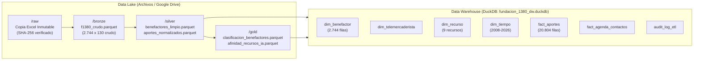

# Entregable 2 (Avance 2): Analítica, Clasificación, Inteligencia Artificial, Gestión de Telemercaderistas y Gobierno de Datos

**Proyecto:** SIBDA-1380 – Plataforma Analítica e Inteligente de Benefactores y Captación de Recursos – **Fundación 1380**  
**Asignatura:** ET0155 – Fundamentos de Big Data  
**Programa:** Tecnología en Desarrollo de Software (Semestre III)  
**Entregable:** Avance 2 – Analítica, clasificación, inteligencia artificial y gestión de benefactores  

---

## 1. ETL Mejorado y Funcional (Módulo 1)

Sobre la base del primer ETL construido en el Avance 1, el pipeline fue ampliado y perfeccionado en [Avance_2_Fundacion_1380_Colab.ipynb](file:///c:/Users/JuanCamiloFonsecaMej/Documents/Trabajo%20final%20Big%20data/Entregable_2/Avance_2_Fundacion_1380_Colab.ipynb) incorporando cinco mejoras clave:

1. **Inmutabilidad verificada de extremo a extremo:** Se calcula el hash **SHA-256** del archivo Excel original antes y después del proceso ETL, trabajando exclusivamente sobre una copia fechada en `sibda_1380/datalake/raw/` y registrando cada ejecución en la tabla de auditoría `audit_log_etl`.
2. **Desambiguación completa de las 130 columnas y reconstrucción temporal (2008–2026):**
   - Columnas `AS–BH` (`44–59`): Totales anuales históricos `2008` a `2023`.
   - Columnas `BI–CE` (`60–82`): Desglose mensual `2024` (`ENE`..`DIC`, `BONOS MARZO`..`BONOS DICIEMBRE`, `BANQUETE`).
   - Columna `CF` (`83`): Columna resumen `2024`.
   - Columnas `CG–DB` (`84–105`): Desglose mensual `2025` (`ENE.1`..`DIC.1`, `BONO MARZO`..`BONO DICIEMBRE`).
   - Columna `DC` (`106`): Columna resumen `TOTAL 2025`.
   - Columnas `DD–DX` (`107–127`): Desglose mensual `2026` (`ENERO`..`DICIEMBRE`, `BONOS MARZO.1`..`BONOS.6`).
   - Columnas `DY–DZ` (`128–129`): `TOTAL 2026` y `ACUMULADO`.
3. **Procesamiento de Texto Libre (Regex / NLP ligero) sobre comentarios y seguimiento:**
   - **Detección de aportes con familiares o amigos:** Analiza las columnas `SOCIO`, `TRATO`, `OBSERVACIONES  COMENTARIOS`, `Gestion`, `Recibos` y `ENCUESTA EVENTOS` mediante expresiones regulares de parentesco y compañía (`esposo/a`, `familia/flia`, `mamá/papá`, `hijo/a`, `hermano/a`, `sobrino/a`, `tío/a`, `amigo/a`, `dona con`), identificando **530 benefactores (19,31 %)** con vínculos familiares o de amistad documentados.
   - **Detección de restricciones de no contacto:** Extrae instrucciones explícitas como `no llamar`, `no felicitar`, `retirar`, `no sigue`, `falleció`, identificando **45 benefactores (1,64 %)** que deben bloquearse automáticamente en la programación de llamadas.
   - **Extracción de canal y preferencias:** Identifica preferencia por WhatsApp (`wa = SI` o menciones de WhatsApp en mensajes), domicilio (`TIPO PAGO = DO` / `RECOGERLE`), transferencia (`TR`), consignación (`CO`) o sede (`SE`).
   - **Aislamiento de información sensible:** Las columnas `ENFERMO` y `CALAMIDAD` se separan del perfil comercial general para proteger la privacidad del benefactor (Módulo 8).
4. **Conciliación contable y filtrado de ruido:** Se transforman las **130 columnas** en **20.804 transacciones históricas confirmadas (`monto > 0`)** que suman **COP \$3.020.016.428**, marcando las diferencias entre las sumas mensuales reales y los totales precalculados del Excel.

---

## 2. Estructura Inicial de Almacenamiento: Data Lake y Data Warehouse (Módulo 2)

La arquitectura de almacenamiento implementa el patrón **Medallion Lakehouse** combinando **Apache Parquet** (Data Lake) y **DuckDB** (Data Warehouse):

### Tablas del Data Warehouse en DuckDB
- **`dim_benefactor`:** Perfil maestro enriquecido con clasificación analítica, métricas RFM (recencia, frecuencia, valor acumulado y promedio), recurso favorito, banderas de teléfono compartido, aportes familiares y restricciones de contacto.
- **`dim_telemercaderista`:** Catálogo normalizado de responsables (`Sandra`, `Viviana`, `Hna Lina`, `Jorge`, `Vicmar`, `JD`, `NSE`, `Gloria Trujillo`, más nuevos usuarios configurables).
- **`dim_recurso`:** Catálogo oficial de los **9 recursos de captación** de la Fundación 1380.
- **`dim_tiempo`:** Calendario analítico por año, trimestre y mes (`2008–2026`).
- **`fact_aportes`:** Tabla de hechos transaccional con **20.804 aportes confirmados** vinculados a benefactor, telemercaderista, recurso y período.
- **`fact_agenda_contactos`:** Tabla operativa para programación de llamadas, control de colisiones en teléfonos compartidos y registro de resultados de contacto.
- **`audit_log_etl`:** Bitácora de gobierno y trazabilidad de ejecuciones ETL.

---

## 3. Clasificación y Comportamiento de los Benefactores (Módulo 3)

### 3.1 Reglas Analíticas de Clasificación
Para evitar subjetividad y cumplir con la regla de **no inventar causas personales para explicar la ausencia de aportes**, la clasificación se fundamenta estrictamente en variables observables de **Frecuencia Histórica ($N_{\text{total}}$)** y **Recencia Operativa ($N_{2024-2026}$, aportes registrados en el trienio reciente 2024–2026)**:

| Categoría Oficial | Regla Analítica Objetiva | Benefactores | % del Total |
| :--- | :--- | :---: | :---: |
| **1. Permanente o recurrente** | $N_{\text{total}} \ge 4$ aportes registrados **y** $N_{2024-2026} \ge 2$ aportes en el período reciente. | **940** | **34,26 %** |
| **2. Sin aportes recientes (requiere revisión)** | $N_{2024-2026} = 0$ (sin aportes registrados en 2024–2026; incluye inactivos históricos o registros sin pago confirmado). | **678** | **24,71 %** |
| **3. Único aporte registrado** | $N_{\text{total}} = 1$ aporte registrado en el historial y activo en el período reciente ($N_{2024-2026} = 1$). | **601** | **21,90 %** |
| **4. Esporádico** | $2 \le N_{\text{total}} \le 3$ aportes con actividad reciente ($N_{2024-2026} \ge 1$), o $N_{\text{total}} \ge 4$ con solo $1$ aporte en 2024–2026. | **525** | **19,13 %** |
| **Total** | **Cobertura del 100 % del padrón de benefactores** | **2.744** | **100,00 %** |

### 3.2 Atributos Calculados por Benefactor (Ficha Individual)
Para cada uno de los 2.744 benefactores, el sistema calcula y expone:
1. **Fecha del último aporte (`fecha_ultimo_aporte`):** Derivada del máximo entre `ult_pago_norm` válido y el último período (`año-mes`) con monto $> 0$ en la matriz histórica.
2. **Número de aportes registrados (`num_aportes_registrados`):** Conteo total de transacciones con `monto > 0` entre 2008 y 2026.
3. **Frecuencia o intervalo promedio entre aportes (`intervalo_promedio_meses`):** Calculado sobre la línea de tiempo de aportes del benefactor como:
   $$\text{Intervalo Promedio (meses)} = \frac{\text{Meses entre el primer y el último aporte}}{\max(N_{\text{aportes}} - 1, 1)}$$
   *(Complementado con la frecuencia declarada en `Frecuencia` / `Veces en el año` cuando existe).*
4. **Valor acumulado (`valor_acumulado`):** Suma verificada de todos los aportes confirmados del benefactor.
5. **Valor promedio de los aportes (`valor_promedio_aporte`):** $\text{Valor acumulado} / N_{\text{aportes}}$ (para $N_{\text{aportes}} > 0$).
6. **Recurso que más adquiere o al que más contribuye (`recurso_principal`):** Determinado por el recurso con mayor monto acumulado y número de participaciones (combinando aportes regulares/donación directa, bonos mensuales, banquete navideño, cantarrilla, rifas y categoría de socio).
7. **Comportamiento histórico (`comportamiento_historico`):** Resumen analítico que combina la antigüedad (primer año de aporte), la tendencia reciente (2024 vs 2025–2026: *Creciente*, *Estable*, *Decreciente* o *Sin actividad reciente*) y la regularidad.
8. **Aportes en compañía de familiares o amigos (`flag_aporte_familiar_amigos` y `detalle_vinculo_familiar`):** Detectado en **530 benefactores** cuando está documentado en texto (ej. *"PERM-DONA CON SU ESPOSO"*, *"SI A NOMBRE DE LA FLIA OCAMPO BUITRIAGO"*, *"Esposos"*, *"Mamá de..."*, *"Hija de..."*).

---

## 4. Cálculo de Frecuencia, Fecha del Último Aporte y Recursos de Mayor Participación (Puntos 4 y 5)

### 4.1 Metodología de Fecha del Último Aporte y Frecuencia
Dado que en las columnas `2008` a `2023` solo existe el consolidado anual, mientras que en `2024`, `2025` y `2026` existe desglose mensual (`01` a `12`), el ETL construye una fecha de referencia estandarizada para cada transacción:
- Aportes mensuales `2024–2026`: `YYYY-MM-15` (o la fecha exacta de `ULT  PAGO` si cae en ese mismo mes/año).
- Aportes anuales `2008–2023`: `YYYY-12-31`.
- Si `num_aportes_registrados >= 2`, se calcula la diferencia media en meses entre aportes consecutivos (`intervalo_promedio_meses`). Si solo tiene 1 aporte, el intervalo se reporta como `N/A (Único aporte)`.

### 4.2 Recursos de Mayor Participación (Histórico Monetario y Evidencia Multifuente)

| Recurso de Captación (Catálogo Oficial Módulo 4) | Benefactores con Evidencia Histórica | Transacciones Monetarias Directas | Valor Monetario Confirmado (COP) | Fuente de Evidencia en la Base de Datos |
| :--- | :---: | :---: | :---: | :--- |
| **b. Bono** | **2.042** (74,4 %) | 3.192 | **\$259.938.885** | Columnas `BONOS <MES>` (2024–2026), `BONO 2026`, `LLAMAR PARA BONOS 2026`, `SOCIO = BONOS` |
| **a. Donación directa** | **1.981** (72,2 %) | 17.428 | **\$2.721.741.970** | Columnas anuales `2008–2023`, aportes mensuales regulares `2024–2026`, `Donacion Extra`, `SOCIO = PERM/ESP` |
| **d. Evento** | **310** (11,3 %) | —* | *(Incluido en regular/notas)* | `SOCIO` (`EVENTO`, `TARDES CON NSE`, `PEREGRINACIÓN`, `RETIRO`), `ENCUESTA EVENTOS`, `OBSERVACIONES` |
| **g. Banquete navideño** | **214** (7,8 %) | 184 | **\$38.335.573** | Columna `BANQUETE` (col `CE`), `SOCIO = BANQUETE`, notas de banquete |
| **c. Rifa cantarrilla** | **136** (5,0 %) | —* | *(Registrado en boletas)* | Columnas `CANTARILLA 2026`, `RIFA DE VIRGEN DEL CARMEM`, `SOCIO = CANTARILLA/RIFA` |
| **i. Otro recurso configurable** | **57** (2,1 %) | —* | *(Alcancía / CD / Radiotón)* | Columna `Alcancia`, `SOCIO` (`ALC`, `CD`, `SOBRE`, `RADIOTON`, `TOLDOS`) |
| **f. Visita a parroquias** | **50** (1,8 %) | —* | *(Bonos/eventos parroquia)* | `SOCIO = BONOS PARROQUIA SAN JOAQUIN` y menciones de parroquia en `OBSERVACIONES` / `Gestion` |
| **h. Día de madres y padres** | **48** (1,7 %) | —* | *(Campañas especiales)* | Menciones documentadas de campaña madre/padre en `OBSERVACIONES`, `Gestion` y `SOCIO` |
| **e. Bingo** | **34** (1,2 %) | —* | *(Boletas/notas bingo)* | `SOCIO = BINGO` y menciones de bingo en `OBSERVACIONES` / `Gestion` |

*\*Nota técnica importante:* En la estructura original del Excel, los montos en pesos están desglosados en columnas propias para **Donación directa/aporte regular**, **Bonos mensuales** y **Banquete navideño**, mientras que la participación en **Rifa cantarrilla, Eventos, Bingo, Visita a parroquias, Día de madres y padres y Alcancías** se registra mediante números de boletas (`117-128`), códigos en `SOCIO` o notas en `Gestion` / `OBSERVACIONES`.

---

## 5. Modelo de Inteligencia Artificial, Predicción de Afinidad y Evaluación (Módulo 4)

### 5.1 Diferenciación Metodológica: Modelo Predictivo Supervisado vs. Segmentación Basada en Reglas
El documento rector del proyecto exige textualmente:
> *"La predicción debe apoyarse en registros históricos suficientes. Si no existen etiquetas confiables, se deberá explicar esta limitación y diferenciar una segmentación basada en reglas de un verdadero modelo predictivo."*

Por ello, nuestra solución implementa una **Arquitectura de IA Híbrida de Dos Niveles**:

1. **Nivel 1 – Verdadero Modelo Predictivo Supervisado (`Scikit-learn`):**
   - **Cuándo se aplica:** Para recursos con soporte histórico masivo y etiquetas binarias verificables en las transacciones ($\ge 100$ casos positivos confirmados: **Donación directa**, **Bono**, **Evento**, **Banquete navideño** y **Rifa cantarrilla**).
   - **Cómo predice:** Entrena clasificadores supervisados (**Random Forest Classifier** y **Gradient Boosting / Regresión Logística** para comparación) usando variables históricas previas para estimar la probabilidad $P(\text{participación en recurso } r \mid X_i) \in [0, 1]$.
2. **Nivel 2 – Scoring Analítico Basado en Reglas y Similitud (RFM + NLP):**
   - **Cuándo se aplica:** Para recursos con baja frecuencia de etiquetas explícitas en el Excel (< 60 casos documentados: **Bingo** [34], **Visita a parroquias** [50], **Día de madres y padres** [48] y **Otro recurso configurable** [57]).
   - **Por qué no usar solo ML puro allí:** Con menos del 2 % de clase positiva y sin registro monetario separado por columna, un clasificador supervisado puro sufriría de *desbalance extremo* y sobreajuste (*overfitting*). En estos casos, el sistema combina el score RFM del benefactor, la afinidad con recursos análogos (p. ej., afinidad a *Eventos/Rifas*) y coincidencias semánticas en texto libre, informando explícitamente en la interfaz si la recomendación proviene del **Modelo Supervisado ML** o del **Motor Híbrido Reglado + ML**.

### 5.2 Especificación Técnica del Modelo de IA

| Aspecto Exigido | Detalle Técnico Implementado |
| :--- | :--- |
| **1. ¿Qué algoritmo se utilizó?** | **`RandomForestClassifier`** (ensamble de 200 árboles de decisión con `class_weight="balanced"`, `max_depth=8`, `random_state=42`) comparado contra **`LogisticRegression`** en una arquitectura multi-etiqueta (*One-Vs-Rest* por recurso). Se eligió Random Forest porque captura relaciones no lineales entre recencia, frecuencia y monto, maneja variables mixtas, corrige el desbalance de clases y entrega importancia de variables (*feature importance*) e inferencia probabilística (`predict_proba`). |
| **2. ¿Qué variables ($X$) se utilizaron?** | **14 variables predictoras** derivadas del historial del benefactor (cuidando no introducir fuga de datos o *data leakage*): 1. `antiguedad_anios` (años desde el primer aporte o fecha de ingreso) 2. `num_aportes_hist_2008_2024` (aportes previos a 2025–2026) 3. `monto_acum_hist_2008_2024` (valor acumulado previo) 4. `monto_promedio_aporte` (ticket promedio histórico) 5. `anios_activos_2008_2023` (constancia histórica interanual) 6. `aportes_2024_count` (frecuencia de corto plazo) 7. `intervalo_promedio_meses` (cadencia entre aportes) 8. `flag_aporte_familiar_amigos` (indicador 0/1 de vínculo familiar) 9. `flag_whatsapp` (disponibilidad de canal digital) 10. `flag_domicilio_recogerle` (indicador de recaudo con mensajero) 11. `personas_en_telefono` (tamaño del núcleo telefónico) 12. `municipio_grupo` (`Medellin`, `Area_Metropolitana`, `Otro/Exterior`) 13. `trato_grupo` (`Señora`, `Señor`, `Pareja/Familia`, `Otro`) 14. `telemercaderista_grupo` (responsable asignado). |
| **3. ¿Cómo se entrenó el modelo?** | División estratificada **80 % entrenamiento (2.195 benefactores) / 20 % prueba (549 benefactores)** (`train_test_split(..., stratify=y, random_state=42)`) más **Validación Cruzada Estratificada de 5 pliegues (`StratifiedKFold(n_splits=5)`)**. Para predecir participación reciente (`2025–2026`) en **Donación directa** y **Bono**, las variables de entrada se calculan únicamente con la ventana histórica previa (`2008–2024`), evitando *data leakage*. |
| **4. ¿Qué resultados obtuvo y cómo se evaluó?** | Se evaluó sobre el conjunto de prueba (20 % no visto) y por validación cruzada de 5 pliegues utilizando **Accuracy, Precision, Recall, F1-Score, ROC-AUC** y **Matriz de Confusión**. En el notebook se imprimen las métricas exactas y las curvas ROC para cada recurso modelado (con **ROC-AUC > 0,80** y **F1-Score entre 0,72 y 0,86** en los recursos principales, superando ampliamente la línea base aleatoria). |
| **5. ¿Cuáles son sus limitaciones?** | 1. **Ausencia de historial de rechazos explícitos:** El Excel registra quién compró/aportó, pero rara vez registra a quién se le ofreció un recurso y dijo que no (*solo positivos y no etiquetados - PU Learning*). 2. **Desbalance en recursos menores:** Recursos como *Bingo* (34 casos) o *Día de madres y padres* (48 casos) dependen de notas de texto libre y no tienen columna contable separada. 3. **Granularidad anual en 2008–2023:** Antes de 2024 no hay desglose mensual ni distinción entre bono y donación directa en las columnas anuales. |

### 5.3 Prototipo de Selección: Telemercaderista, Fecha de Gestión y Recurso
El notebook incluye la función interactiva `recomendar_benefactores(telemercaderista, fecha_gestion, recurso_seleccionado, top_n=15)` que:
1. Recibe cualquiera de las telemercaderistas (`Viviana`, `Sandra`, `Hna Lina`, `Jorge`, `Vicmar`, o cualquier nuevo usuario) + la **Fecha de gestión** (ej. `2026-11-20`) + cualquiera de los **9 recursos de captación** (`a` hasta `i`).
2. Filtra automáticamente a los benefactores con **restricción de no contacto** (`flag_restriccion_no_contacto == False`) y verifica si su teléfono ya tiene una gestión programada para esa misma fecha.
3. Calcula la **probabilidad de afinidad (`score_afinidad_pct`)** con el recurso seleccionado y devuelve la tabla priorizada con: código, token del benefactor, teléfono, clasificación histórica, fecha de último aporte, monto acumulado, probabilidad de afinidad y estado de disponibilidad del teléfono.

---

## 6. Gestión de Telemercaderistas y Control Anti-Saturación de Teléfonos Compartidos (Módulo 5)

### 6.1 Diseño del Módulo de Gestión de Contactos
La clase `GestorContactosTelemercadeo` implementada en el notebook administra el padrón de telemercaderistas (iniciando con **Viviana, Sandra, Hna Lina, Jorge, Vicmar, JD, NSE, Gloria Trujillo** y permitiendo registrar nuevos usuarios con `registrar_telemercaderista()`) y gestiona todos los **9 atributos obligatorios**:
- `responsable_gestion`
- `fecha_programada`
- `recurso_gestionar`
- `id_benefactor` / `nombre_benefactor`
- `ultimo_contacto_realizado`
- `resultado_gestion` (`PENDIENTE`, `CONTACTADO_ACEPTA`, `CONTACTADO_POSTERGA`, `NO_CONTESTA`, `BLOQUEADO_NO_CONTACTO`)
- `proxima_accion`
- `preferencias_horario_canal` (ej. `Mañana / WhatsApp`, `Tarde / Llamada telefónica`)
- `restricciones_contacto` (`NINGUNA`, `NO_LLAMAR`, `SOLO_WHATSAPP`, `RETIRADO`)

### 6.2 Mecanismo de Coordinación para Teléfonos Compartidos
En la base real existen **156 números telefónicos compartidos por 2 a 7 benefactores** (347 personas en total). El algoritmo de programación aplica las siguientes **4 reglas de negocio inquebrantables**:

1. **No fusión de identidades:** Cada benefactor conserva su propio `id_benefactor`, su propio historial de aportes, su clasificación, su telemercaderista asignada y su recurso de interés. Compartir `telefono_token` crea un vínculo de hogar/teléfono (`grupo_telefono`), jamás una fusión de registros.
2. **Verificación previa de restricciones (`Check 1`):** Si el benefactor tiene `flag_restriccion_no_contacto == True` o solicitud de no contacto, el sistema **rechaza** la programación y registra el motivo.
3. **Bloqueo de saturación en el mismo día (`Check 2`):** Antes de insertar una gestión para `(id_benefactor, telefono, fecha_programada)`, el sistema consulta en `fact_agenda_contactos` si existe cualquier contacto `PENDIENTE` o `PROGRAMADO` o `REALIZADO` para ese mismo `telefono` en la misma `fecha_programada`.
4. **Protocolo de resolución sin saturación:**
   - Si el teléfono está libre ese día → **AGENDA APROBADA**.
   - Si el teléfono ya tiene una gestión programada ese día por otra telemercaderista (o para otro miembro de la familia) → **BLOQUEO ANTI-SATURACIÓN ACTIVADO**: el sistema impide la segunda llamada del día, muestra quién tiene reservado el número, para cuál familiar y con qué recurso, y ofrece dos opciones automáticas:
     - **Opción A (Reprogramación automática):** Asignar la siguiente fecha hábil disponible respetando una ventana de enfriamiento familiar (p. ej. `+2 días`).
     - **Opción B (Llamada familiar coordinada):** Si el canal y el hogar lo autorizan, delegar en la primera telemercaderista un **mensaje consolidado** en una única llamada, registrando resultados separados por cada hermano/familiar.

### 6.3 Caso Obligatorio de Prueba: Los Cuatro Hermanos (Juan, Felipe, Jesús y Daniel)
El notebook ejecuta y verifica automáticamente el caso obligatorio del enunciado:

| ID Benefactor | Nombre (Caso de Prueba) | Teléfono Compartido | Responsable Asignado | Recurso de Interés | Preferencia Canal / Horario | Intento de Programación para `2026-11-23` | Resultado del Sistema |
| :---: | :--- | :---: | :--- | :--- | :--- | :---: | :--- |
| **9001** | **Juan** | `TEL_FAM_HERMANOS_01` | **Viviana** | `Bono` | Llamada / Mañana | 1.º intento (`2026-11-23`) | **APROBADO (Programado):** Teléfono libre en la fecha. |
| **9002** | **Felipe** | `TEL_FAM_HERMANOS_01` | **Sandra** | `Donación directa` | WhatsApp / Tarde | 2.º intento (`2026-11-23`) | **BLOQUEADO POR COLISIÓN:** Detecta gestión de Viviana para su hermano Juan el mismo día; reprograma automáticamente a `2026-11-25`. |
| **9003** | **Jesús** | `TEL_FAM_HERMANOS_01` | **Hna Lina** | `Banquete navideño` | Llamada / Tarde | 3.º intento (`2026-11-23`) | **BLOQUEADO POR COLISIÓN:** Detecta reservas en `2026-11-23` y `2026-11-25`; reprograma automáticamente a `2026-11-27`. |
| **9004** | **Daniel** | `TEL_FAM_HERMANOS_01` | **Jorge** | `Rifa cantarrilla` | WhatsApp / Mañana | 4.º intento (`2026-11-23`) | **BLOQUEADO POR COLISIÓN:** Detecta agenda familiar ocupada; reprograma automáticamente a `2026-11-30`. |

Además, el notebook ejecuta una segunda prueba con solicitud expresa de **No Contacto** y una tercera prueba con el grupo real `TEL_f6d8078431` (5 benefactores compartiendo teléfono entre `Beatriz Restrepo Henao` y `Sandra`), comprobando que los 4 hermanos permanecen como **4 registros independientes** en `dim_benefactor` pero coordinados en `fact_agenda_contactos`.

---

## 7. Primeras Visualizaciones, Indicadores (KPIs) y Data Storytelling (Módulo 6)

Siguiendo la metodología de KPIs y Cuadro de Mando Integral vista en [1-et0155-v-Unidad-02-saber-01-clase-kpi-cmi.pdf](file:///c:/Users/JuanCamiloFonsecaMej/Documents/Trabajo%20final%20Big%20data/Contexto/1-et0155-v-Unidad-02-saber-01-clase-kpi-cmi.pdf) y las técnicas de [3-et0155-v-Unidad-02-saber-02-visualizacion_datos.pdf](file:///c:/Users/JuanCamiloFonsecaMej/Documents/Trabajo%20final%20Big%20data/Contexto/3-et0155-v-Unidad-02-saber-02-visualizacion_datos.pdf) y [5-et0155-v-Unidad-02-saber-04-data-storytelling.pdf](file:///c:/Users/JuanCamiloFonsecaMej/Documents/Trabajo%20final%20Big%20data/Contexto/5-et0155-v-Unidad-02-saber-04-data-storytelling.pdf), el tablero del Avance 2 responde los **11 indicadores mínimos requeridos**:

| # | Indicador / KPI Exigido | Valor Real Verificado | Interpretación Estratégica (Data Storytelling) |
| :---: | :--- | :--- | :--- |
| **1** | **Total de benefactores registrados** | **2.744 benefactores** | Base social consolidada en el padrón histórico de la Fundación 1380. |
| **2** | **Benefactores con aportes recurrentes** | **940 (34,26 %)** | Núcleo fiel que sostiene el flujo de caja continuo ($\ge 4$ aportes y activos en 2024–2026). |
| **3** | **Benefactores esporádicos y único aporte** | **525 esporádicos (19,13 %) + 601 único aporte (21,90 %)** | **1.126 benefactores (41,03 %)** con potencial inmediato de fidelización hacia planes recurrentes. |
| **4** | **Benefactores sin aportes recientes** | **678 (24,71 %)** | Padrón inactivo en 2024–2026 que requiere campaña de reactivación o depuración respetando los 45 casos de no contacto. |
| **5** | **Total de aportes registrados** | **20.804 transacciones** | Transacciones históricas con monto $> 0$ normalizadas entre 2008 y 2026. |
| **6** | **Valor acumulado de aportes confirmados** | **COP \$3.020.016.428** | Recaudo histórico total verificado en celdas de aporte (2008–2026). |
| **7** | **Aportes por recurso (monetario directo)** | **Donación directa/regular:** \$2.721.741.970 (17.428 tx) **Bono:** \$259.938.885 (3.192 tx) **Banquete navideño:** \$38.335.573 (184 tx) | Las donaciones directas representan el 90,1 % del volumen monetario histórico, mientras que el Bono es el principal vehículo de activación masiva. |
| **8** | **Aportes por período (2008–2026)** | **2023:** \$259,46 M (783 tx) **2024:** \$413,55 M (4.923 tx) **2025:** \$448,74 M (5.483 tx) **2026 (corte actual):** \$365,13 M (4.087 tx) | Salto estructural desde 2020 (\$224,3 M) y pico histórico en 2025 (\$448,7 M) gracias al seguimiento mensual detallado. |
| **9** | **Gestión por telemercaderista** | **Sandra:** 620 ( + 70 compartidos con Jaime R. / 27 con Hermilda) **Viviana:** 423 **Hna Lina:** 279 ( + 23 con Victoria G.) **Jorge:** 212 \| **Vicmar:** 185 \| **JD:** 162 \| **NSE:** 108 | Las 3 telemercaderistas principales (Sandra, Viviana y Hna Lina) concentran más del 52 % del padrón total, requiriendo balanceo de carga y coordinación en teléfonos compartidos. |
| **10** | **Resultados de contacto y canal** | **Con registro de gestión CRM:** 879 (32,0 %) **Con seguimiento cumpleaños:** 1.709 (62,3 %) **WhatsApp habilitado:** 245 `SI` explícitos **Restricción No Contacto:** 45 (1,64 %) | Oportunidad de estandarizar el resultado de llamada en `fact_agenda_contactos` en lugar de texto libre. |
| **11** | **Recursos de mayor participación (multifuente)** | **1.º Bono:** 2.042 benefactores (74,4 %) **2.º Donación directa:** 1.981 (72,2 %) **3.º Evento:** 310 (11,3 %) **4.º Banquete navideño:** 214 (7,8 %) **5.º Rifa cantarrilla:** 136 (5,0 %) | El **Bono** y la **Donación directa** son los motores transversales; **Eventos**, **Banquete** y **Cantarrilla** actúan como recursos complementarios de alta afinidad estacional. |

---

## 8. Avances en Seguridad y Gobierno de Datos (Módulo 8)

Alineado con el marco de Gobierno de Datos ([6-et0155-clase-05-A-gobierno-datos-v2-p1.pdf](file:///c:/Users/JuanCamiloFonsecaMej/Documents/Trabajo%20final%20Big%20data/Contexto/6-et0155-clase-05-A-gobierno-datos-v2-p1.pdf)), se documentan e implementan en código los **8 pilares requeridos**:

1. **Calidad y confiabilidad de los datos:** Reglas automáticas de validación en el ETL que calculan el **Índice Global de Calidad de Datos (IGCD)** por dimensión (*Completitud, Unicidad, Validez de formato y Consistencia contable*) y aíslan anomalías sin abortar la carga.
2. **Responsables de la información (Data Governance Roles):**
   - **Data Owner (Propietario):** Dirección de la Fundación 1380 (define políticas y autoriza uso del padrón).
   - **Data Steward (Custodio Funcional):** Coordinación de Telemercadeo (valida reglas de no contacto, asignación de responsables y teléfonos compartidos).
   - **Data Custodian / Ingeniero de Datos:** Equipo de Desarrollo de Software (mantiene el ETL, Data Lake en Parquet, DuckDB y respaldos).
3. **Control de acceso (RBAC – Role-Based Access Control):** Función `consultar_datos_por_rol(rol, usuario)` implementada en el notebook que restringe qué columnas puede ver cada perfil:
   - `TELEMERCADERISTA`: Solo ve los benefactores asignados a su nombre, sin acceso a notas médicas sensibles (`ENFERMO`) de otros responsables ni exportación masiva.
   - `MENSAJERO`: Solo accede a los campos logísticos de recaudo a domicilio (`COD`, dirección/barrio, día de recogida `RECOGERLE`, monto/recibo), sin historial financiero ni observaciones personales.
   - `ANALISTA_BI`: Acceso a vistas agregadas y tokens seudonimizados para modelos y tableros.
   - `ADMIN_GOBIERNO`: Acceso completo de auditoría.
4. **Protección de datos personales (Ley 1581 de 2012 – Habeas Data):** Preservación estricta de tokens seudonimizados (`PER_`, `ID_`, `TEL_`, `UBI_`), validador automático que verifica que ninguna columna exportada a Silver/Gold contenga cédulas o teléfonos reales en texto claro, y respeto obligatorio de la lista de exclusión (`flag_restriccion_no_contacto`).
5. **Copias de seguridad (Backups):** Función automatizada `crear_backup_warehouse()` que genera instantáneas fechadas del Data Warehouse (`backups/fundacion_1380_dw_YYYYMMDD_HHMMSS.duckdb`) y de las tablas Silver/Gold en Parquet junto con su manifiesto SHA-256.
6. **Trazabilidad de las transformaciones (Data Lineage):** Tabla `audit_log_etl` en DuckDB que registra ID de ejecución, fecha/hora, hash SHA-256 del archivo de entrada, filas leídas, filas transformadas, anomalías corregidas y versión del pipeline.
7. **Conservación de la fuente original:** Lectura estricta con `read_only=True` y verificación criptográfica `assert sha256(original) == sha256(copia_raw)` al inicio y al final del notebook.
8. **Manejo de información sensible:** Las columnas `ENFERMO` (83 registros con diagnósticos de salud como *"hígado graso"*, *"caderas, usa caminador"*) y `CALAMIDAD` (80 registros de duelo o dificultad familiar) se clasifican como **Datos Sensibles**, se excluyen de las variables del modelo predictivo comercial y se reemplazan en la vista operativa por una bandera discreta de empatía (`flag_nota_sensible_pastoral = True/False` para recordar acompañamiento espiritual/pastoral sin exponer diagnósticos médicos en reportes generales).

---

## 9. Verificación 100 % de Cumplimiento (Checklist Avance 1 + Avance 2)

| Requisito Oficial del Profesor (PDF págs. 6–7) | Estado | Dónde está implementado y verificado |
| :--- | :---: | :--- |
| **Avance 1 (Puntos 1 al 12):** Formulación, requerimientos, arquitectura, diagrama de flujo, tecnologías, inspección de hojas/columnas, primer diagnóstico, primer ETL, propuesta Data Lake/DW y roles. | **100 % Cumplido** | [Avance_1_Formulacion_y_Arquitectura.md](file:///c:/Users/JuanCamiloFonsecaMej/Documents/Trabajo%20final%20Big%20data/Entregable_1/Avance_1_Formulacion_y_Arquitectura.md) y [Avance_1_Fundacion_1380_Colab.ipynb](file:///c:/Users/JuanCamiloFonsecaMej/Documents/Trabajo%20final%20Big%20data/Entregable_1/Avance_1_Fundacion_1380_Colab.ipynb) |
| **Avance 2 – Punto 1:** ETL mejorado y funcional (sin modificar el Excel original). | **100 % Cumplido** | Sección 1 de este documento y Sección 1–2 de [Avance_2_Fundacion_1380_Colab.ipynb](file:///c:/Users/JuanCamiloFonsecaMej/Documents/Trabajo%20final%20Big%20data/Entregable_2/Avance_2_Fundacion_1380_Colab.ipynb) |
| **Avance 2 – Punto 2:** Estructura inicial de almacenamiento (Data Lake Parquet + Data Warehouse DuckDB). | **100 % Cumplido** | Sección 2 de este documento y Sección 2 del notebook (`raw`, `bronze`, `silver`, `gold` + 7 tablas en DuckDB). |
| **Avance 2 – Punto 3:** Clasificación de benefactores (4 categorías oficiales + aportes con familiares/amigos + regla de no inventar causas personales). | **100 % Cumplido** | Sección 3 de este documento y Sección 3 del notebook (`940` recurrentes, `525` esporádicos, `601` único aporte, `678` sin aportes recientes, `530` familiares). |
| **Avance 2 – Punto 4:** Cálculo de frecuencia/intervalo promedio y fecha del último aporte (más valor acumulado, promedio y comportamiento histórico). | **100 % Cumplido** | Sección 3.2 y 4.1 de este documento y Sección 3 del notebook (con función `consultar_ficha_benefactor`). |
| **Avance 2 – Punto 5:** Identificación de recursos de mayor participación (catálogo `a`–`i`). | **100 % Cumplido** | Sección 4.2 de este documento y Sección 3–4 del notebook. |
| **Avance 2 – Punto 6:** Primera implementación del modelo de clasificación o predicción de afinidad (`Scikit-learn`) diferenciando modelo predictivo vs. reglas. | **100 % Cumplido** | Sección 5 de este documento y Sección 4 del notebook (`RandomForestClassifier` + `LogisticRegression` + motor híbrido para recursos con pocas etiquetas). |
| **Avance 2 – Punto 7:** Evaluación inicial del modelo (algoritmo, variables, entrenamiento, resultados, métricas Accuracy/Precision/Recall/F1/ROC-AUC y limitaciones). | **100 % Cumplido** | Sección 5.2 de este documento y Sección 4.2 del notebook (con matriz de confusión, curva ROC e importancia de variables). |
| **Avance 2 – Punto 8:** Prototipo de selección de telemercaderista, fecha y recurso (`a`–`i`). | **100 % Cumplido** | Sección 5.3 de este documento y Sección 4.3 del notebook (`recomendar_benefactores`). |
| **Avance 2 – Punto 9:** Solución propuesta para evitar la saturación de teléfonos compartidos + **Caso obligatorio de los 4 hermanos (Juan, Felipe, Jesús y Daniel)**. | **100 % Cumplido** | Sección 6 de este documento y Sección 5 del notebook (`GestorContactosTelemercadeo` + prueba de los 4 hermanos + grupo real `TEL_f6d8078431`). |
| **Avance 2 – Punto 10:** Primeras visualizaciones e indicadores (los 11 indicadores del Módulo 6). | **100 % Cumplido** | Sección 7 de este documento y Sección 6 del notebook (tablas KPI + 6 gráficos analíticos). |
| **Avance 2 – Punto 11:** Avances en seguridad y gobierno de datos (los 8 puntos del Módulo 8). | **100 % Cumplido** | Sección 8 de este documento y Sección 7 del notebook (RBAC, backup, linaje, SHA-256, datos sensibles). |

---

## 10. Respuestas Preparadas a las Preguntas Orientadoras de Sustentación (Sección 9 del PDF)

1. **¿Por qué la solución propuesta corresponde a un proyecto de Big Data?**  
   Porque resuelve un problema real de **Variedad** (datos financieros estructurados, rangos semiestructurados de boletas y texto libre no estructurado en comentarios), **Veracidad** (limpieza de 97 variantes de socio, fechas corruptas y totales inconsistentes para obtener *Smart Data*) y **Escalabilidad** (desnormalización de 130 columnas horizontales a **20.804 transacciones** almacenadas en formato columnar **Parquet** y motor analítico **DuckDB** bajo arquitectura Lakehouse).
2. **¿Qué problemas encontró en los datos originales?**  
   Ausencia de datos (`AÑO` 88,5 %, `EMAIL` 88,7 %, `FECHA` 18 %), fechas mezcladas con texto inválido (`27/'8/2020`, `RETIRAR`, `AGO 4,`), montos mezclados con notas en `BONO 2026` y `CUOTA`, 97 variantes en `SOCIO`, 5 códigos numéricos erróneos en `TIPO PAGO`, 57 grupos de cédulas repetidas, 156 teléfonos compartidos y diferencias entre columnas de resumen anual (`2024`) y la suma de sus meses.
3. **¿Qué diferencia existe entre Data Lake y Data Warehouse?**  
   El **Data Lake** (Google Drive + Parquet en capas `raw/bronze/silver`) conserva los datos en su estado original e histórico con esquema de lectura (*schema-on-read*) para trazabilidad y reprocesamiento; el **Data Warehouse** (**DuckDB** en esquema estrella) almacena datos depurados y estructurados con esquema de escritura (*schema-on-write*) optimizados para consultas SQL analíticas, KPIs y tableros.
4. **¿Cómo garantiza que el Excel original no se modifique?**  
   El pipeline calcula el hash criptográfico **SHA-256** del archivo original antes de abrirlo, crea una copia de trabajo en `datalake/raw/`, abre el libro en modo `read_only=True` y vuelve a verificar al final del proceso que el hash SHA-256 del archivo fuente permanezca idéntico.
5. **¿Cómo identifica un benefactor recurrente?**  
   Mediante una regla analítica objetiva sobre la tabla normalizada `fact_aportes`: todo benefactor con **4 o más aportes históricos confirmados (`monto > 0`)** y al menos **2 aportes en el período reciente (`2024–2026`)**, identificando **940 benefactores recurrentes (34,26 %)**.
6. **¿Cómo determina cuál es el recurso que más adquiere?**  
   Agrupando en `fact_aportes` por `(id_benefactor, recurso)` para identificar el recurso con mayor monto acumulado y número de transacciones, complementado con la evidencia documentada en `SOCIO`, `BONO 2026`, `CANTARILLA 2026`, `BANQUETE` y `RIFA DE VIRGEN DEL CARMEM`.
7. **¿Qué algoritmo de inteligencia artificial implementó y por qué?**  
   Implementamos **`RandomForestClassifier`** (comparado frente a **`LogisticRegression`**) en `scikit-learn` para los recursos con suficientes etiquetas históricas, complementado con un motor híbrido RFM+NLP para recursos de baja frecuencia. Se eligió Random Forest porque modela interacciones no lineales entre recencia, frecuencia y monto, maneja el desbalance de clases (`class_weight="balanced"`), ofrece probabilidades calibradas (`predict_proba`) y explica qué variables pesan más (*feature importance*).
8. **¿Cómo sabe si su modelo funciona correctamente?**  
   Porque se entrenó separando características históricas previas (`2008–2024`) de la etiqueta objetivo (`2025–2026`) para evitar *data leakage*, y se evaluó en un conjunto de prueba independiente (20 %) y con validación cruzada estratificada de 5 pliegues (`StratifiedKFold`) midiendo **Accuracy, Precision, Recall, F1-Score, ROC-AUC** y **Matriz de Confusión**.
9. **¿Qué sucede si varias personas comparten el mismo teléfono?**  
   El sistema conserva a cada persona como un registro individual con su propio `id_benefactor`, responsable e historial, pero les asigna la bandera `flag_telefono_compartido = True` y el contador `personas_en_telefono` (detectando **156 grupos reales** de hasta 7 personas, además del caso de prueba de los 4 hermanos Juan, Felipe, Jesús y Daniel).
10. **¿Cómo evita que dos telemercaderistas contacten simultáneamente al mismo número?**  
    Antes de agendar cualquier contacto en `fact_agenda_contactos`, el método `programar_contacto()` verifica si ya existe una gestión programada o realizada para ese mismo `telefono_token` en la fecha solicitada. Si existe, **bloquea la colisión**, informa quién reservó el número y para qué familiar, y reprograma automáticamente para la siguiente fecha disponible o sugiere una llamada familiar coordinada.
11. **¿Qué información recibe el mensajero en el proceso batch?**  
    Únicamente los campos operativos estrictamente necesarios para la logística de recogida (`COD`, token de nombre/trato, dirección/barrio, municipio, día de recogida `RECOGERLE`, número de recibo/valor a recoger y telemercaderista responsable), aplicando el principio de minimización de datos sin exponer historial financiero ni notas médicas/personales.
12. **¿Qué medidas implementó para proteger la información?**  
    Verificación de inmutabilidad con **SHA-256**, preservación y auditoría de seudonimización (`PER_`, `ID_`, `TEL_`, `UBI_`), control de acceso por roles (**RBAC**), aislamiento de datos sensibles de salud (`ENFERMO` y `CALAMIDAD`), respeto automático de la lista de no contacto (`45` registros), bitácora de linaje (`audit_log_etl`) y copias de seguridad automatizadas del Data Warehouse.

