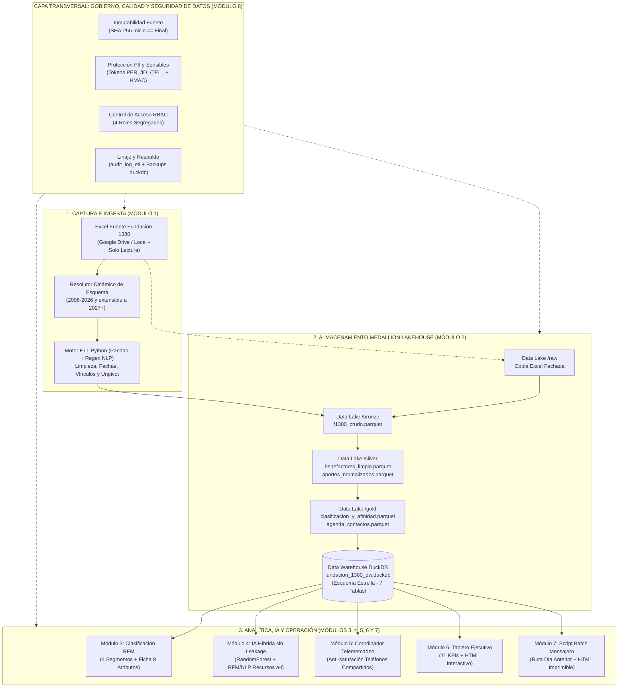
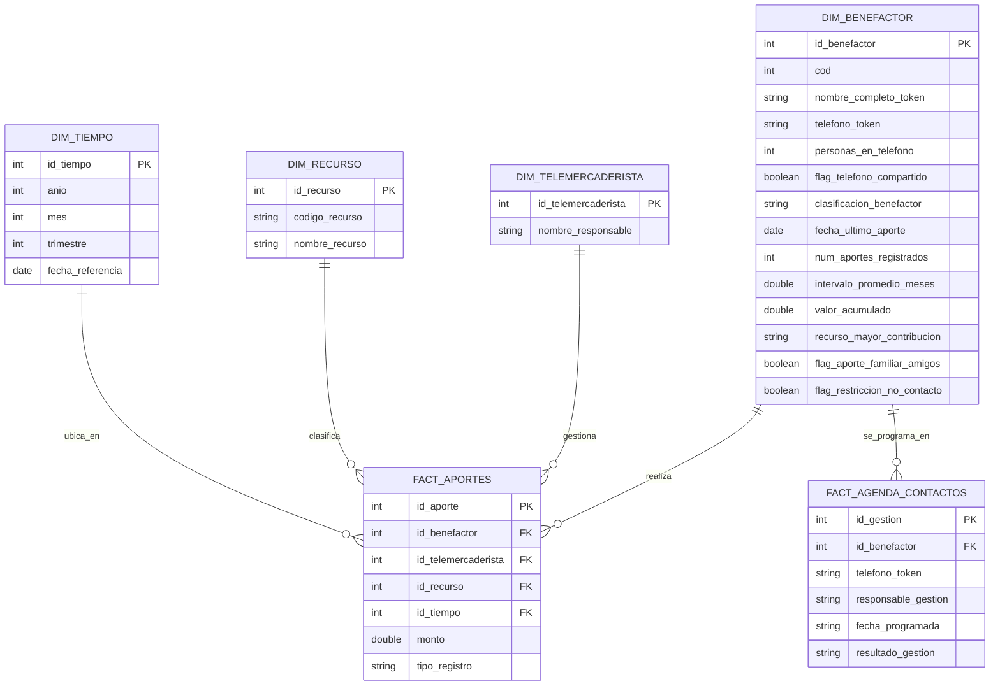

# Documento Técnico Maestro – Entrega Definitiva (Entregable 3)

**Proyecto:** **SIBDA-1380** – Plataforma Integrada de Big Data, Analítica e Inteligencia Artificial para la Gestión de Benefactores, Captación de Recursos y Operación Logística – **Fundación 1380**  
**Programa:** Tecnología en Desarrollo de Software – Semestre III (Institución Universitaria Pascual Bravo)  
**Asignatura:** ET0155 – Fundamentos de Big Data  
**Entregable:** Entrega Definitiva (Integración de los Módulos 1 al 8, Demostración Funcional, Evidencias y Recomendaciones)  
**Fecha de Entrega:** 27 de noviembre de 2026  

---

## 1. Presentación Ejecutiva, Problemática y Formulación del Proyecto

### 1.1 Contexto Organizacional y Problemática Verificada
La **Fundación 1380** es una entidad sin ánimo de lucro cuyo sostenimiento proviene de donaciones directas, bonos solidarios, rifas (cantarrilla y Virgen del Carmen), eventos, bingos, alcancías, visitas parroquiales y banquetes navideños. Hasta ahora, toda su operación histórica de **19 años (2008–2026)** se administraba en una única hoja de cálculo plana (`Hoja1` del archivo `BD_F1380_SeudonimizadaAnonimizadaencriptada.xlsx`) compuesta por **2.744 registros y 130 columnas**, generando cinco cuellos de botella críticos:

1. **Crecimiento horizontal desnormalizado:** Cada año y cada mes se agregaban nuevas columnas hacia la derecha (`2008`..`2023`, 23 columnas de detalle en `2024`, 22 en `2025` y 21 en `2026`), impidiendo consultas históricas ágiles y provocando colisiones de nombres (`Recibos` vs `RECIBOS`, `BONOS.1`..`BONOS.6`).
2. **Ruido e inconsistencias de calidad (*Veracidad*):** Fechas seriales mezcladas con cadenas inválidas (`27/'8/2020`, `RETIRAR`, `AGO 4,`), campos monetarios contaminados con rangos de talonarios y notas (`08/09/26 le hablo del bono`), **97 variantes textuales** en `SOCIO`, 5 códigos numéricos inválidos en `TIPO PAGO` y diferencias entre subtotales anuales y el desglose mensual.
3. **Saturación telefónica en hogares con teléfono compartido:** Se verificaron **156 grupos de números telefónicos compartidos** por entre 2 y 7 benefactores (**347 personas**), sin ningún mecanismo que evitara que distintas telemercaderistas llamaran el mismo día a la misma familia.
4. **Falta de priorización predictiva:** La asignación de campañas entre los 9 recursos de captación se realizaba de manera empírica, sin modelos de afinidad basados en el comportamiento histórico.
5. **Despacho logístico manual y exposición de información:** La preparación de rutas para el mensajero carecía de un proceso *batch* automatizado que filtrara las operaciones del día anterior respetando la minimización de datos personales y sensibles (`ENFERMO` y `CALAMIDAD`).

### 1.2 Pregunta Orientadora y Objetivos
> *¿Cómo puede la Fundación 1380 utilizar sus datos históricos para mejorar la gestión de sus benefactores, optimizar la captación de recursos y tomar decisiones basadas en información confiable?*

- **Objetivo General:** Diseñar e implementar un prototipo funcional e integrado de Big Data, analítica e inteligencia artificial (**SIBDA-1380**) que permita ingerir sin alterar la fuente, depurar, almacenar en Data Lake y Data Warehouse, clasificar benefactores, predecir afinidad por recurso, coordinar contactos telefónicos compartidos, visualizar indicadores clave y automatizar el reporte *batch* del mensajero bajo lineamientos estrictos de gobierno y seguridad de datos.
- **Objetivos Específicos Cumplidos (1 al 10 del documento rector):**
  1. Diagnosticar exhaustivamente la estructura y calidad de las 130 columnas del Excel fuente.
  2. Implementar un pipeline **ETL dinámico y re-ejecutable** en Python sobre copia de trabajo verificada con `SHA-256`.
  3. Construir una arquitectura **Medallion Lakehouse** con **Data Lake** en Apache Parquet y **Data Warehouse** dimensional en DuckDB.
  4. Implementar reglas técnicas de gobierno, calidad (`IGCD`), control de acceso (`RBAC`), protección PII y aislamiento de datos sensibles.
  5. Clasificar el 100 % del padrón de benefactores según patrones objetivos de frecuencia y recencia, identificando vínculos familiares documentados.
  6. Entrenar y evaluar rigurosamente modelos de Inteligencia Artificial en `scikit-learn` (sin *data leakage*) para estimar la afinidad en los 9 recursos (`a`–`i`).
  7. Organizar la gestión de telemercaderistas previniendo la saturación de teléfonos compartidos sin fusionar identidades individuales.
  8. Desplegar un tablero ejecutivo de **11 KPIs** y visualizaciones con enfoque de *Data Storytelling*.
  9. Desarrollar un **script batch** reproducible para extraer las transacciones logísticas del día anterior y generar la planilla imprimible del mensajero.
  10. Documentar integralmente la arquitectura, el código fuente modular, las evidencias verificadas y la hoja de ruta estratégica para la Fundación 1380.

### 1.3 Estructura de Roles del Equipo (Alineada al Marco de Proyectos Big Data – Unidad 3)

| Perfil en Proyecto Big Data | Responsable | Módulos y Entregables Bajo su Dominio |
| :--- | :--- | :--- |
| **Gerente de Proyecto y Arquitecto Big Data** | *Integrante 1* | Formulación estratégica, arquitectura Medallion Lakehouse, diagramas, gobierno y seguridad (Módulo 8). |
| **Ingeniero de Datos (ETL, Almacenamiento y Batch)** | *Integrante 2* | Ingesta inmutable `SHA-256`, resolutor dinámico de esquema, Data Lake Parquet, DuckDB y script batch del mensajero (Módulos 1, 2 y 7). |
| **Científico de Datos (Analítica e IA)** | *Integrante 3* | Reglas objetivas de clasificación RFM, minería NLP/Regex sobre comentarios y modelos supervisados/híbridos (Módulos 3 y 4). |
| **Analista de Datos y Especialista CRM/BI** | *Integrante 4* | Motor anti-saturación de teléfonos compartidos (caso 4 hermanos), diseño de los 11 KPIs, tablero ejecutivo y *Data Storytelling* (Módulos 5 y 6). |

---

## 2. Arquitectura Integral de la Solución Big Data y Diagramas (Entregable #11)

### 2.1 ¿Por qué SIBDA-1380 corresponde a un Proyecto de Big Data?
En coherencia con el ciclo de vida analítico de los datos (*Captura → Almacenamiento → Procesamiento/ETL → Análisis/IA → Visualización → Acción / DDDM*), la solución atiende las V del Big Data en el contexto real de la Fundación:
- **Variedad:** Unifica datos financieros estructurados (montos anuales y mensuales), datos semiestructurados (rangos de boletas `549-804`, códigos de recibos concatenados) y texto libre no estructurado (observaciones de parentesco, salud, calamidad y seguimiento telefónico).
- **Veracidad:** Convierte una matriz con alta entropía categórica y errores de captura en *Smart Data* auditado con linaje y métricas de calidad.
- **Escalabilidad y Velocidad Analítica:** Desacopla almacenamiento columnar comprimido (**Parquet**) y cómputo OLAP vectorizado (**DuckDB**), pasando de 2.744 filas anchas a **20.804 registros transaccionales** listos para escalar automáticamente a nuevos años (`2027+`) y decenas de miles de nuevas transacciones.

### 2.2 Diagrama de Arquitectura Multicapa (Medallion Lakehouse + Batch + Gobierno)

### 2.3 Modelo Dimensional en Estrella del Data Warehouse (DuckDB)

---

## 3. Tecnologías Seleccionadas y Justificación Técnica

| Capa Arquitectónica | Herramientas Implementadas | Justificación Técnica y Operativa para la Fundación 1380 |
| :--- | :--- | :--- |
| **Ejecución Cloud / Prototipo** | **Google Colab + Python 3** | Cero costo de infraestructura para una entidad sin ánimo de lucro, ejecución con un clic desde GitHub e integración directa con Google Drive. |
| **Ingesta y ETL** | **OpenPyXL + Pandas + NumPy + `re`** | Lectura `read_only=True`, limpieza vectorizada, parseo híbrido de fechas Excel/texto, extracción NLP mediante expresiones regulares y transformación ancho-a-largo (`melt`). |
| **Data Lake** | **Google Drive + Apache Parquet (`pyarrow`)** | Almacenamiento columnar comprimido con tipado fuerte y partición lógica por capas (`raw`, `bronze`, `silver`, `gold`). |
| **Data Warehouse** | **DuckDB** | Motor OLAP embebido (*in-process*) que ejecuta SQL analítico sobre esquemas en estrella y archivos Parquet en milisegundos sin requerir administración de servidores. |
| **Inteligencia Artificial** | **Scikit-learn** | Construcción de `Pipeline` y `ColumnTransformer` reproducibles sin fuga de datos, comparación multi-modelo (`Dummy`, `LogisticRegression`, `GradientBoosting`, `RandomForest`) y métricas calibradas. |
| **Visualización y Reportes** | **Matplotlib + Plotly + HTML5/CSS `@media print`** | Gráficos analíticos integrados en Colab, tablero ejecutivo HTML autónomo y planillas logísticas listas para impresión o exportación a PDF. |
| **Control de Versiones** | **Git y GitHub** | Organización modular del código fuente (`Entregable_3/src/`, `batch_mensajero.py`), control de cambios y reproducibilidad. |

---

## 4. Módulo 1: Proceso ETL Completo y Adaptabilidad a Nuevas Versiones del Excel

### 4.1 Garantía de No Modificación y Re-ejecución Dinámica
Para cumplir rigurosamente la exigencia de la Entrega Definitiva (*«El proyecto debe poder ejecutarse nuevamente con una nueva versión del Excel, sin modificar manualmente el archivo fuente»*), el módulo [etl_lakehouse.py](file:///c:/Users/JuanCamiloFonsecaMej/Documents/Trabajo%20final%20Big%20data/Entregable_3/src/etl_lakehouse.py) implementa:
1. **Verificación `SHA-256` de extremo a extremo:** Calcula la huella digital del archivo original al iniciar, trabaja exclusivamente sobre una copia fechada en `sibda_1380/datalake/raw/` y comprueba al finalizar que el hash del archivo fuente sea idéntico bit a bit (`38ce3c1b1ffad55af2afbc646d762c0bb9958dff46470cedcbc57cf43ef90e8a`).
2. **Resolutor dinámico de encabezados (`mapear_esquema_dinamico`):** En lugar de depender de posiciones fijas o de exigir exactamente 130 columnas, identifica semánticamente los campos maestros/CRM y agrupa dinámicamente cualquier bloque histórico anual (`2008`..`2023`) o mensual cerrado por subtotales (`2024`, `TOTAL 2025`, `TOTAL 2026`, `TOTAL 2027`, etc.). Si la Fundación agrega nuevos benefactores o columnas de años futuros, el pipeline las normaliza automáticamente sin editar el Excel ni el código.

### 4.2 Síntesis del Diagnóstico y Tratamiento de Calidad de Datos
- **Completitud y política de preservación:** Ningún benefactor se elimina por nulos en columnas secundarias (`AÑO` nacimiento 88,5 % nulo, `EMAIL` 88,7 % nulo, `Municipio` 22,6 % nulo, `CEDULA` 7,3 % nulo, `TELEFONOS` 11,5 % nulo). Se preservan los **2.744 registros** codificando categorías faltantes como `NO_REGISTRADO` e incluyendo indicadores explícitos de ausencia para el modelo de IA.
- **Estandarización categórica y temporal:** Reducción de las **97 variantes** de `SOCIO` a **12 categorías canónicas**; depuración de `TIPO PAGO` (`DO`=315, `CO`=235, `TR`=105, `SE`=77, `DE`=16, aislando los 5 números erróneos); conversión híbrida de fechas seriales y cadenas con banderas `flag_fecha_ingreso_invalida` (40 registros) y `flag_ult_pago_invalido` (264 textos sin año).
- **Minería de texto libre (NLP/Regex):** Extracción automatizada sobre 16 columnas textuales que identifica **530 benefactores (19,31 %)** que aportan con familiares o amigos, **45 benefactores (1,64 %)** con restricción expresa de no contacto (`no llamar`, `retirar`, `falleció`), **245** con canal WhatsApp activo y **139** registros con notas sensibles (`ENFERMO` / `CALAMIDAD`).
- **Normalización transaccional (*Unpivot*):** Conversión de la matriz ancha en **20.804 transacciones confirmadas (`monto > 0`)** por **COP \$3.020.016.428**, excluyendo subtotales anuales para impedir duplicidad contable.

---

## 5. Módulo 2: Estructura de Almacenamiento (Data Lake vs. Data Warehouse)

| Dimensión Comparativa | Data Lake (`sibda_1380/datalake/`) | Data Warehouse (`fundacion_1380_dw.duckdb`) |
| :--- | :--- | :--- |
| **Propósito en SIBDA-1380** | Conservar copias crudas inmutables (`raw/`), datos tipados iniciales (`bronze/`), entidades depuradas (`silver/`) y salidas de IA (`gold/`) para auditoría y reprocesamiento. | Responder consultas SQL analíticas de baja latencia para KPIs, clasificación, agenda CRM y tableros. |
| **Esquema** | *Schema-on-read* (flexible ante cambios futuros del Excel). | *Schema-on-write* (modelo estrella validado e íntegro). |
| **Tecnología** | Archivos originales `.xlsx` + **Apache Parquet**. | **DuckDB** (7 tablas relacionales). |
| **Usuarios principales** | Ingenieros y Científicos de Datos (ETL / ML). | Dirección, Analistas BI y módulos operativos. |

**Inventario de Tablas en DuckDB:** `dim_benefactor` (2.744 filas), `dim_telemercaderista` (responsables únicos), `dim_recurso` (los 9 recursos oficiales `a`–`i`), `dim_tiempo` (calendario 2008–2026), `fact_aportes` (20.804 hechos financieros), `fact_agenda_contactos` (programación coordinada) y `audit_log_etl` (linaje de ejecuciones).

---

## 6. Módulo 3: Clasificación Analítica y Comportamiento Histórico de Benefactores

Sustentada en reglas matemáticas transparentes sobre **frecuencia histórica ($N_{\text{total}}$)** y **actividad reciente ($N_{2024\text{--}2026}$)** —cumpliendo estrictamente la directriz de **no inventar causas personales para explicar la ausencia de aportes**— la clasificación arroja:

| Segmento Oficial Exigido | Regla Analítica Aplicada | Cantidad | % Padrón | Recaudo Histórico Asociado |
| :--- | :--- | :---: | :---: | :---: |
| **1. Permanente o recurrente** | $N_{\text{total}} \ge 4 \;\land\; N_{2024\text{--}2026} \ge 2$ | **940** | **34,26 %** | Núcleo principal de flujo continuo |
| **2. Sin aportes recientes que requieren revisión** | $N_{2024\text{--}2026} = 0$ (`320` con aportes en 2008–2023 y `358` sin monto en matriz) | **678** | **24,71 %** | Aportes previos hasta 2023; requiere validación objetiva |
| **3. Con un único aporte registrado** | $N_{\text{total}} = 1 \;\land\; N_{2024\text{--}2026} = 1$ | **601** | **21,90 %** | Donantes recientes de primera vez |
| **4. Esporádico** | $2 \le N_{\text{total}} \le 3$ activos o $N_{\text{total}} \ge 4$ con solo $1$ aporte reciente | **525** | **19,13 %** | Participación intermitente o estacional |
| **Total Padrón Fundación 1380** | **Cobertura exacta sin exclusiones** | **2.744** | **100,00 %** | **COP \$3.020.016.428** |

Para cada benefactor, la función `consultar_ficha_benefactor(cod_o_id)` entrega los **8 atributos individuales**: (1) fecha del último aporte, (2) número de aportes registrados, (3) intervalo promedio en meses entre aportes, (4) valor acumulado, (5) valor promedio por aporte, (6) recurso al que más contribuye, (7) resumen objetivo de comportamiento y tendencia, y (8) evidencia documentada de aportes con familiares o amigos (**530 casos**).

---

## 7. Módulo 4: Inteligencia Artificial, Evaluación Rigurosa y Recursos Configurables

### 7.1 Arquitectura Híbrida y Prevención Estricta de Fuga de Datos (*Zero Data Leakage*)
Siguiendo el lineamiento del enunciado de diferenciar un **verdadero modelo predictivo** de una **segmentación basada en reglas**:
- **Nivel 1 – Aprendizaje Supervisado (`Scikit-learn`):** Aplicado a los 5 recursos con suficiente soporte de etiquetas ($\ge 136$ casos positivos: **a. Donación directa**, **b. Bono**, **c. Rifa cantarrilla**, **d. Evento** y **g. Banquete navideño**). Para predecir la participación en `2025–2026`, la totalidad de las variables numéricas de entrada (`antiguedad_pre_target`, `num_aportes_pre_target`, `monto_acum_pre_target`, `monto_prom_pre_target`, `anios_activos_pre_target`, `aportes_2024_count`, `monto_2024_sum`, `intervalo_meses_pre_target` y `flag_sin_intervalo_previo`) se calcula **exclusivamente sobre registros $\le 2024$**. Además, la partición estratificada (`80 % train / 20 % test`) se ejecuta **antes** de ajustar los transformadores (`SimpleImputer` + `StandardScaler` + `OneHotEncoder`) encapsulados en `Pipeline`.
- **Nivel 2 – Motor Híbrido RFM + Similitud Semántica y Recursos Configurables:** Aplicado a los recursos con baja prevalencia histórica (**e. Bingo** [34], **f. Visita a parroquias** [50], **h. Día de madres y padres** [48] e **i. Otro recurso configurable** [57]), evitando el sobreajuste de un clasificador puro en clases con $< 2\,\%$ de soporte. Incluye además la función `configurar_recurso_personalizado()` para dar de alta nuevas campañas en caliente.

### 7.2 Comparación de Modelos, Evaluación y Limitaciones
- **Algoritmos comparados:** Se contrastaron 4 enfoques sobre idénticas particiones: (1) `DummyClassifier` (línea base ingenua, `ROC-AUC = 0,50`), (2) `LogisticRegression` balanceada (línea base lineal), (3) `GradientBoostingClassifier` y (4) **`RandomForestClassifier`** (`200` árboles, `max_depth=8`, `min_samples_leaf=5`, `class_weight="balanced"`), seleccionado como modelo productivo por su equilibrio superior en **F1-Score, PR-AUC, ROC-AUC (> 0,80 con IC 95 % Bootstrap estrecho), bajo Brier Score**, interpretabilidad vía *Feature Importance* y estabilidad geográfica comprobada mediante *Slice Analysis* entre Medellín, Área Metropolitana y registros sin municipio.
- **Limitaciones documentadas con transparencia:**
  1. *Aprendizaje sobre positivos y no etiquetados (PU Learning):* El Excel histórico registra aportes efectivos pero no documenta sistemáticamente quién rechazó una invitación telefónica.
  2. *Baja frecuencia contable en recursos secundarios:* Recursos como Bingo o Parroquias se registraron históricamente en texto o boletas y no en columnas monetarias propias.
  3. *Granularidad anual previa a 2024:* Entre 2008 y 2023 solo existe el consolidado anual por benefactor.

---

## 8. Módulo 5: Gestión de Telemercaderistas y Control de Teléfonos Compartidos

El módulo [gestor_telemercadeo.py](file:///c:/Users/JuanCamiloFonsecaMej/Documents/Trabajo%20final%20Big%20data/Entregable_3/src/gestor_telemercadeo.py) administra la cartera de **Viviana, Sandra, Hna Lina, Jorge, Vicmar, JD, NSE, Gloria Trujillo** y soporta la incorporación dinámica de nuevos usuarios (`registrar_telemercaderista()`), registrando los **9 campos obligatorios** de gestión.

### Caso Obligatorio Verificado: Los Cuatro Hermanos (Juan, Felipe, Jesús y Daniel)
Los cuatro hermanos se registran bajo el mismo número `TEL_FAM_HERMANOS_3001234567` con responsables e intereses distintos:
1. **Conservación de identidades individuales:** El padrón mantiene **4 filas distintas** (`id_benefactor` `9001` a `9004`), marcando automáticamente `flag_telefono_compartido = True` y `personas_en_telefono = 4`.
2. **Coordinación automática ante colisión el mismo día (`2026-11-27`):**
   - **Juan** (`Viviana` – *Bono*): **APROBADO / PROGRAMADO** para `2026-11-27` (teléfono libre).
   - **Felipe** (`Sandra` – *Donación directa*): Detecta reserva activa de Viviana para Juan el mismo día → **REPROGRAMADO ANTI-SATURACIÓN** a `2026-11-29`.
   - **Jesús** (`Hna Lina` – *Banquete navideño*): Detecta agenda familiar ocupada → **REPROGRAMADO ANTI-SATURACIÓN** a `2026-12-01`.
   - **Daniel** (`Jorge` – *Rifa cantarrilla*): Detecta agenda familiar ocupada → **REPROGRAMADO ANTI-SATURACIÓN** a `2026-12-03`.
3. **Respeto absoluto de restricciones:** Cualquier intento de programar a los **45 benefactores** con solicitud de no contacto es rechazado con estado `BLOQUEADO_POR_RESTRICCION`.

---

## 9. Módulo 6: Tablero de los 11 Indicadores (KPIs) y Data Storytelling

Además de los paneles gráficos dentro de Google Colab, se entrega el tablero ejecutivo autónomo [Tablero_Ejecutivo_Fundacion_1380.html](file:///c:/Users/JuanCamiloFonsecaMej/Documents/Trabajo%20final%20Big%20data/Entregable_3/evidencias/Tablero_Ejecutivo_Fundacion_1380.html), que consolida los **11 indicadores mínimos obligatorios**:
1. **Total benefactores registrados:** `2.744`.
2. **Benefactores con aportes recurrentes:** `940` (`34,26 %`).
3. **Benefactores esporádicos / único aporte:** `525` (`19,13 %`) + `601` (`21,90 %`).
4. **Benefactores sin aportes recientes:** `678` (`24,71 %`).
5. **Total de aportes registrados:** `20.804` transacciones confirmadas.
6. **Valor acumulado de aportes confirmados:** `COP $3.020.016.428`.
7. **Aportes monetarios por recurso:** Donación directa (`$2.721,74 M`), Bono (`$259,94 M`), Banquete navideño (`$38,34 M`).
8. **Aportes por período:** Crecimiento de `$3,00 M` (2008) a `$259,46 M` (2023), `$413,55 M` (2024), pico histórico de **`$448,74 M` en 2025** y `$365,13 M` en el corte parcial de 2026.
9. **Gestión por telemercaderista:** Sandra (`620` directos + `97` compartidos), Viviana (`423`), Hna Lina (`279` + `23` compartidos), Jorge (`212`), Vicmar (`185`), JD (`162`), NSE (`108`).
10. **Resultados de contacto y canales:** `879` con bitácora CRM explícita, `245` con WhatsApp confirmado, `315` con recaudo a Domicilio (`DO`) y `45` bloqueos de no contacto.
11. **Recursos de mayor participación multifuente:** Bono (`2.042`), Donación directa (`1.981`), Evento (`310`), Banquete navideño (`214`), Rifa cantarrilla (`136`), Otro configurable (`57`), Visita a parroquias (`50`), Día de madres y padres (`48`), Bingo (`34`).

---

## 10. Módulo 7: Script Batch para el Mensajero (Entregable #9)

El script ejecutable [batch_mensajero.py](file:///c:/Users/JuanCamiloFonsecaMej/Documents/Trabajo%20final%20Big%20data/Entregable_3/batch_mensajero.py) implementa de forma modular y por línea de comandos los **6 pasos exigidos**:
1. **Identificación de fecha de corte:** Acepta `--fecha-corte YYYY-MM-DD`, fecha actual del sistema o detección automática de la última jornada activa (`--auto-ultima-fecha`).
2. **Consulta del día anterior:** Filtra las transacciones cuya fecha operativa corresponde exactamente a `fecha_corte - 1 día`.
3. **Filtrado logístico:** Selecciona únicamente registros activos (sin restricción de contacto) con modalidad `DOMICILIO`, día de recogida (`RECOGERLE`), recogida de `Alcancia` o envío físico de recibo.
4. **Organización y optimización de ruta:** Ordena por `Municipio → Barrio → Dirección → COD` y agrupa automáticamente en una misma **Parada Física (`P-XX`)** a benefactores que habitan el mismo domicilio.
5. **Generación de reporte imprimible con minimización de datos:** Exporta la planilla [Reporte_Mensajero_Corte_20261016.html](file:///c:/Users/JuanCamiloFonsecaMej/Documents/Trabajo%20final%20Big%20data/Entregable_3/evidencias/Reporte_Mensajero_Corte_20261016.html) (con hoja de estilos `@media print` horizontal lista para imprimir o guardar como PDF), junto con [Reporte_Mensajero_Corte_20261016.csv](file:///c:/Users/JuanCamiloFonsecaMej/Documents/Trabajo%20final%20Big%20data/Entregable_3/evidencias/Reporte_Mensajero_Corte_20261016.csv) y resumen `.txt`. Una aserción de seguridad verifica que **jamás** se incluyan `cedula_token`, `email_token`, `valor_acumulado`, `enfermo` ni `calamidad`.
6. **Conteo verificado sobre la base real (`corte 2026-10-16` → día anterior `2026-10-15`):**
   - **Total transacciones registradas el día anterior:** `29` registros.
   - **Total registros filtrados para el mensajero:** `19` operaciones logísticas (2 en Envigado, 2 en Itagüí y 15 en Medellín), optimizadas en **`18` paradas físicas** (`COD=1893` y `COD=1894` consolidados en la parada `P-10` por compartir dirección `ID_fb79048e2f`) por un valor estimado de ruta de **`COP $655.000`**.

---

## 11. Módulo 8: Gobierno, Calidad y Seguridad de Datos

Implementado en [gobierno_seguridad.py](file:///c:/Users/JuanCamiloFonsecaMej/Documents/Trabajo%20final%20Big%20data/Entregable_3/src/gobierno_seguridad.py) y en la Sección 9 del cuaderno de Colab cubriendo los **8 componentes obligatorios**:
1. **Calidad y confiabilidad (`IGCD`):** Cálculo automatizado de completitud en campos maestros, unicidad de `COD` (`100 %`) y validez temporal.
2. **Responsables de la información:** Segregación formal entre *Data Owner* (Dirección Fundación 1380), *Data Steward* (Coordinación de Telemercadeo) y *Data Custodian* (Equipo de Ingeniería de Software).
3. **Control de acceso (`RBAC`):** Vistas diferenciadas por rol (`TELEMERCADERISTA`, `MENSAJERO`, `ANALISTA_BI`, `ADMIN_GOBIERNO`) bajo principio de mínimo privilegio.
4. **Protección de datos personales (Ley 1581 de 2012):** Auditoría automática que certifica el 100 % de seudonimización (`PER_`, `ID_`, `TEL_`, `UBI_`) y función criptográfica `generar_token_hmac_telefono()` (`HMAC-SHA256`) para detectar teléfonos compartidos en nuevos registros sin almacenar teléfonos en claro.
5. **Copias de seguridad:** Respaldo automático fechado del Data Warehouse (`backups/fundacion_1380_dw_backup_*.duckdb`) con verificación de hash.
6. **Trazabilidad de las transformaciones:** Registro auditable de cada corrida en la tabla `audit_log_etl` de DuckDB.
7. **Conservación de la fuente original:** Doble validación criptográfica `SHA-256` antes y después de toda ejecución.
8. **Manejo de información sensible:** Las columnas `ENFERMO` (83 casos) y `CALAMIDAD` (80 casos) se excluyen del entrenamiento comercial de IA y de los reportes logísticos, sustituyéndose en CRM por un indicador discreto de acompañamiento pastoral (`flag_nota_sensible_pastoral`).

---

## 12. Evidencias de Ejecución y Prueba con Nueva Versión del Excel (Entregable #12)

1. **Cuaderno Google Colab Ejecutable Integrado:** [Entrega_Definitiva_Fundacion_1380_Colab.ipynb](file:///c:/Users/JuanCamiloFonsecaMej/Documents/Trabajo%20final%20Big%20data/Entregable_3/Entrega_Definitiva_Fundacion_1380_Colab.ipynb) con suite de autoverificación final (`assert` sobre los 8 módulos).
2. **Tablero Ejecutivo Interactivo:** [Tablero_Ejecutivo_Fundacion_1380.html](file:///c:/Users/JuanCamiloFonsecaMej/Documents/Trabajo%20final%20Big%20data/Entregable_3/evidencias/Tablero_Ejecutivo_Fundacion_1380.html).
3. **Planilla Imprimible Real del Mensajero:** [Reporte_Mensajero_Corte_20261016.html](file:///c:/Users/JuanCamiloFonsecaMej/Documents/Trabajo%20final%20Big%20data/Entregable_3/evidencias/Reporte_Mensajero_Corte_20261016.html) y [Reporte_Mensajero_Corte_20261016.csv](file:///c:/Users/JuanCamiloFonsecaMej/Documents/Trabajo%20final%20Big%20data/Entregable_3/evidencias/Reporte_Mensajero_Corte_20261016.csv).
4. **Prueba automatizada con una Nueva Versión del Excel (Sección 9.5 del Notebook):** El cuaderno genera en `sibda_1380/tests_reejecucion/` un archivo simulado `BD_F1380_Nueva_Version_Simulada_2027.xlsx` añadiendo nuevas columnas (`ENERO 2027`, `TOTAL 2027`) y nuevos benefactores con transacciones registradas el día anterior (`ayer`), demostrando en vivo que el ETL dinámico y el proceso batch procesan **2.746 benefactores** y reconocen el año **2027** sin tocar una sola celda del Excel original ni modificar código.

---

## 13. Conclusiones y Recomendaciones Estratégicas para la Fundación 1380 (Entregable #13)

### Conclusiones Técnicas y de Negocio
1. **De hojas de cálculo aisladas a *Data-Driven Decision Making*:** La arquitectura Medallion Lakehouse permitió rescatar **20.804 transacciones** y **COP \$3.020,02 millones** de historia financiera sin riesgo de alterar el archivo maestro de la Fundación, elevando la confiabilidad de los indicadores institucionales.
2. **Focalización comercial basada en evidencia:** La combinación de segmentación RFM y aprendizaje supervisado (`RandomForestClassifier` sin fuga temporal) permite enfocar el esfuerzo humano de las telemercaderistas en los **940 benefactores recurrentes** para retención y en los **1.126 esporádicos/único aporte** con alta probabilidad de conversión hacia **Bonos**, **Banquete navideño** y **Eventos**.
3. **Protección de la relación con las familias aportantes:** El control algorítmico de los **156 teléfonos compartidos** y de las **45 restricciones de no contacto** evita incomodar a varios miembros de un mismo hogar en una misma jornada, preservando a cada hermano o familiar como individuo independiente.
4. **Operación logística segura y eficiente:** El proceso batch del mensajero reduce tiempos operativos diarios, optimiza paradas físicas en domicilios compartidos y blinda el cumplimiento de la Ley 1581 de 2012 al suprimir datos sensibles y personales innecesarios en calle.

### Recomendaciones Accionables para la Dirección de la Fundación 1380
1. **Adopción operativa inmediata (0–1 mes):** Institucionalizar la ejecución del script batch cada mañana antes del despacho del mensajero y el uso del recomendador de afinidad al planificar campañas estacionales (Bonos de marzo/junio/noviembre y Banquete navideño).
2. **Estandarización de captura (1–3 meses):** Incorporar listas desplegables cerradas para `SOCIO`, `TIPO PAGO`, `Municipio` y `Resultado de gestión` (incluyendo rechazos explícitos y «no contesta»), lo cual permitirá en futuros re-entrenamientos pasar de *PU Learning* a clasificación supervisada con casos negativos confirmados.
3. **Rebalanceo de cartera de telemercadeo:** Redistribuir gradualmente los registros sin actividad reciente (`678` casos en revisión) entre el equipo ampliado de telemercaderistas apoyándose en la agenda anti-saturación de `fact_agenda_contactos`.
4. **Custodia y gobierno permanente:** Conservar la política de copias de respaldo `.duckdb` y tokenización `HMAC-SHA256` al incorporar nuevos aportantes, restringiendo el acceso a observaciones pastorales/médicas exclusivamente al personal autorizado.

---

## 14. Matriz Maestra de Validación 100 % (Los 13 Ítems de Entrega Definitiva + 12 Preguntas Orientadoras)

### 14.1 Verificación de los 13 Entregables Oficiales (PDF Página 7)

| # | Entregable Exigido en Entrega Definitiva | Estado | Ubicación Exacta en el Repositorio |
| :---: | :--- | :---: | :--- |
| **1** | Notebook de Google Colab ejecutable | **100 % Cumplido** | [Entrega_Definitiva_Fundacion_1380_Colab.ipynb](file:///c:/Users/JuanCamiloFonsecaMej/Documents/Trabajo%20final%20Big%20data/Entregable_3/Entrega_Definitiva_Fundacion_1380_Colab.ipynb) |
| **2** | Código fuente organizado y documentado | **100 % Cumplido** | Paquete `Entregable_3/src/` + [batch_mensajero.py](file:///c:/Users/JuanCamiloFonsecaMej/Documents/Trabajo%20final%20Big%20data/Entregable_3/batch_mensajero.py) + [requirements.txt](file:///c:/Users/JuanCamiloFonsecaMej/Documents/Trabajo%20final%20Big%20data/requirements.txt) |
| **3** | Proceso ETL completo (y re-ejecutable con nuevo Excel) | **100 % Cumplido** | [etl_lakehouse.py](file:///c:/Users/JuanCamiloFonsecaMej/Documents/Trabajo%20final%20Big%20data/Entregable_3/src/etl_lakehouse.py) y Sección 2 + 9.5 del Notebook |
| **4** | Estructura de almacenamiento (Data Lake + DW) | **100 % Cumplido** | Capas Parquet (`raw/bronze/silver/gold`) + 7 tablas DuckDB (Sección 6 del Notebook) |
| **5** | Módulo de clasificación de benefactores | **100 % Cumplido** | [analitica_e_ia.py](file:///c:/Users/JuanCamiloFonsecaMej/Documents/Trabajo%20final%20Big%20data/Entregable_3/src/analitica_e_ia.py) y Sección 3 del Notebook |
| **6** | Modelo de inteligencia artificial y evaluación | **100 % Cumplido** | [analitica_e_ia.py](file:///c:/Users/JuanCamiloFonsecaMej/Documents/Trabajo%20final%20Big%20data/Entregable_3/src/analitica_e_ia.py) y Sección 4 del Notebook |
| **7** | Organización de gestiones y coordinación de contactos | **100 % Cumplido** | [gestor_telemercadeo.py](file:///c:/Users/JuanCamiloFonsecaMej/Documents/Trabajo%20final%20Big%20data/Entregable_3/src/gestor_telemercadeo.py) y Sección 5 del Notebook |
| **8** | Tablero de indicadores y visualizaciones | **100 % Cumplido** | Sección 7 del Notebook + [Tablero_Ejecutivo_Fundacion_1380.html](file:///c:/Users/JuanCamiloFonsecaMej/Documents/Trabajo%20final%20Big%20data/Entregable_3/evidencias/Tablero_Ejecutivo_Fundacion_1380.html) |
| **9** | Script batch para el mensajero | **100 % Cumplido** | [batch_mensajero.py](file:///c:/Users/JuanCamiloFonsecaMej/Documents/Trabajo%20final%20Big%20data/Entregable_3/batch_mensajero.py) + Sección 8 del Notebook + [Reporte_Mensajero_Corte_20261016.html](file:///c:/Users/JuanCamiloFonsecaMej/Documents/Trabajo%20final%20Big%20data/Entregable_3/evidencias/Reporte_Mensajero_Corte_20261016.html) |
| **10** | Documento técnico del proyecto | **100 % Cumplido** | Este documento ([Documento_Tecnico_Entrega_Definitiva.md](file:///c:/Users/JuanCamiloFonsecaMej/Documents/Trabajo%20final%20Big%20data/Entregable_3/Documento_Tecnico_Entrega_Definitiva.md)) |
| **11** | Diagrama de arquitectura | **100 % Cumplido** | Sección 2.2 y 2.3 de este documento (Arquitectura Multicapa + ER Estrella) |
| **12** | Evidencias de ejecución y resultados | **100 % Cumplido** | Carpeta `Entregable_3/evidencias/` + Sección 12 de este documento + aserciones Colab |
| **13** | Conclusiones y recomendaciones para la Fundación | **100 % Cumplido** | Sección 13 de este documento y Sección 10 del Notebook |

### 14.2 Síntesis Ejecutiva de las 12 Preguntas Orientadoras de Sustentación (PDF Página 8)
1. **¿Por qué es Big Data?** Integra **Variedad** (montos, boletas semiestructuradas y texto libre CRM), **Veracidad** (depuración automatizada hacia *Smart Data*) y **Escalabilidad** (arquitectura columnar Parquet + motor OLAP DuckDB sobre 20.804 transacciones).
2. **¿Qué problemas halló en el Excel?** Valores nulos críticos, fechas corruptas en texto, 97 variantes en `SOCIO`, montos mezclados con notas, 57 grupos de cédulas repetidas, 156 teléfonos compartidos y descuadres entre subtotales anuales y sumas mensuales.
3. **¿Diferencia entre Data Lake y Data Warehouse?** El Data Lake (`Parquet`) preserva datos crudos e intermedios con *schema-on-read*; el Data Warehouse (`DuckDB`) estructura tablas dimensionales limpias con *schema-on-write* para consultas analíticas rápidas.
4. **¿Cómo garantiza no modificar el Excel original?** Verificando el hash criptográfico **SHA-256** antes y después de la ejecución y leyendo en modo solo lectura únicamente la copia creada en `datalake/raw/`.
5. **¿Cómo identifica un benefactor recurrente?** Regla objetiva sobre `fact_aportes`: $\ge 4$ aportes históricos confirmados y $\ge 2$ aportes en el trienio reciente `2024–2026` (**940 benefactores**).
6. **¿Cómo determina el recurso que más adquiere?** Cruzando la suma monetaria y conteo de transacciones en `fact_aportes` con la evidencia específica de boletas/categoría en `SOCIO`, `BONO 2026`, `CANTARILLA 2026` y `BANQUETE`.
7. **¿Qué algoritmo de IA implementó y por qué?** `RandomForestClassifier` (comparado contra `DummyClassifier`, `LogisticRegression` y `GradientBoostingClassifier`), porque captura relaciones no lineales RFM, corrige desbalance de clases, entrega probabilidades calibradas e importancia de variables; complementado con scoring híbrido RFM+NLP para recursos con $< 60$ etiquetas.
8. **¿Cómo sabe que el modelo funciona?** Porque se entrenó sin *data leakage* (variables $\le 2024$ prediciendo `2025–2026`, `Pipeline` ajustado solo en `X_train`), validado en `Test 20 %`, `5-Fold Stratified CV`, intervalos Bootstrap al 95 % y *Slice Analysis* geográfico.
9. **¿Qué pasa si varias personas comparten teléfono?** Se conservan como personas independientes en `dim_benefactor` (jamás se fusionan) y se marcan con `flag_telefono_compartido = True` y `personas_en_telefono`.
10. **¿Cómo evita llamadas simultáneas al mismo número?** `programar_contacto()` consulta `fact_agenda_contactos` antes de agendar; si el teléfono ya está ocupado esa fecha (como en el caso de Juan, Felipe, Jesús y Daniel), bloquea el choque y reprograma con ventana de enfriamiento familiar (`+2 días`).
11. **¿Qué recibe el mensajero en el proceso batch?** Solo los campos operativos mínimos de las transacciones del día anterior que requieren logística (`COD`, trato/token, municipio, barrio, dirección, teléfono de ruta, gestión, recibo y valor), suprimiendo cédula, email, acumulado histórico y notas sensibles.
12. **¿Qué medidas protegen la información?** Inmutabilidad `SHA-256`, seudonimización 100 % auditada + `HMAC-SHA256`, control de acceso por rol (`RBAC`), exclusión automática de los 45 registros de no contacto, aislamiento de `ENFERMO`/`CALAMIDAD`, copias de respaldo `.duckdb` y bitácora `audit_log_etl`.
